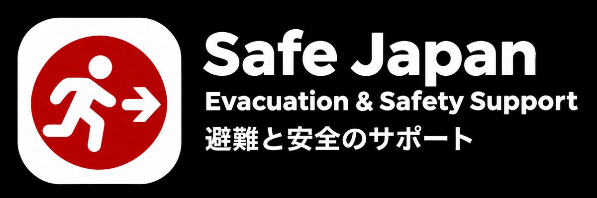
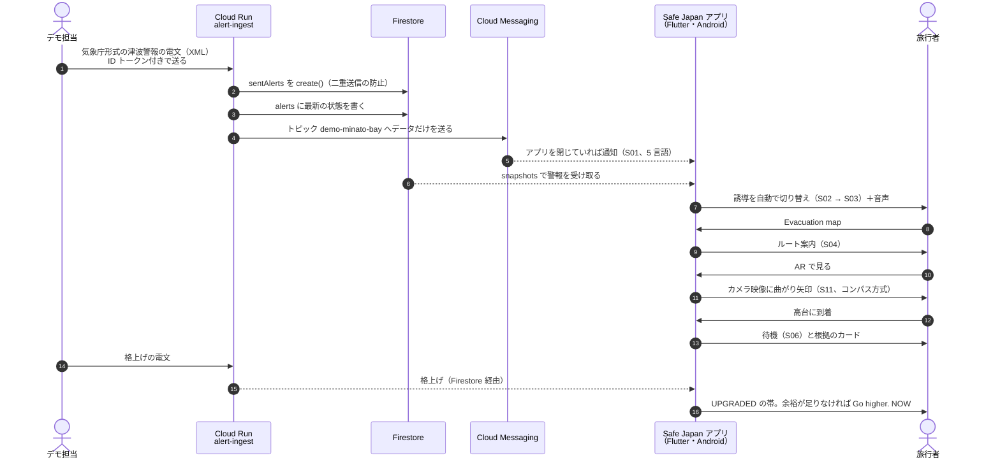
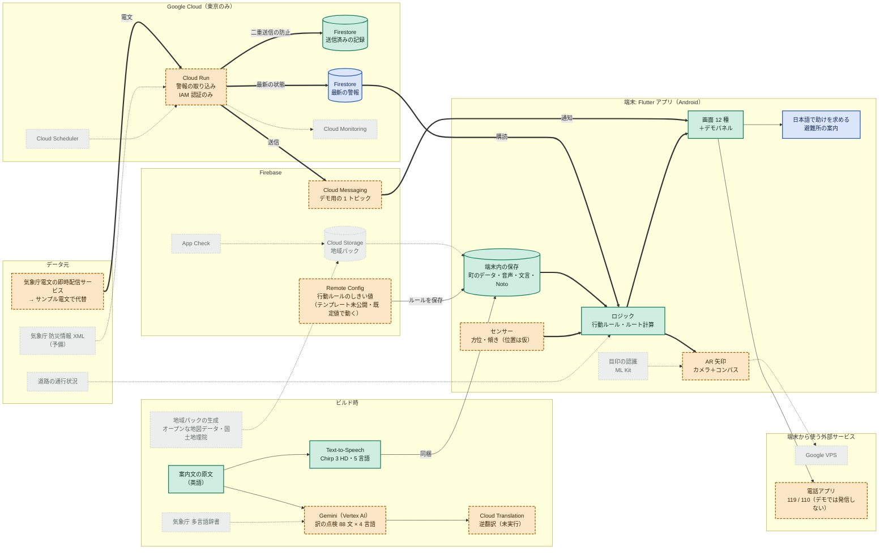
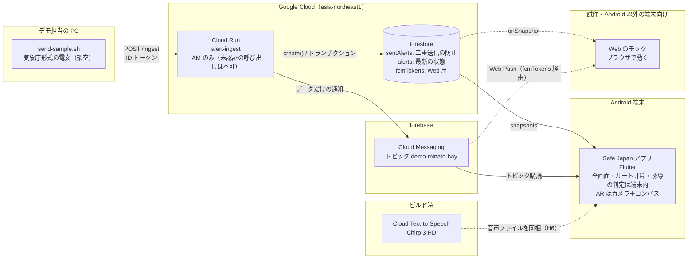

# Safe Japan — 訪日外国人のための災害時避難誘導

> DevFest Hackathon 2026 提出作品。
> 画面に出る警報・地名・住所はすべて架空です（画面に常に `DEMO` / `SIMULATED ALERT` を表示）。舞台の「みなと湾（Minato Bay）」は実在しない町です。

## 1. Safe Japan とは

日本を訪れた外国人旅行者が、地震・津波に遭ったときに **「母語で」「今やる行動を 1 つだけ」「通信が切れても」** 受け取れるようにする避難誘導アプリです。

**提出物の本体は Flutter の Android アプリ（`apps/ar_guide/`）です。** 全画面・デモ操作パネル・音声・Firestore の警報の購読・FCM の通知・カメラの AR 案内を 1 つのアプリに入れています。最初に作った Web のモック（`mocks/evacuate/`）は、試作と、Android 以外の端末向けの代わりとして残しています。

### 解決したい課題

| 旅行者が困ること | 具体的な場面 | Safe Japan の対応 |
|---|---|---|
| 日本語の警報が読めない | 緊急速報メールは届くが、「大津波警報」「高台へ避難」が読めず、周りの人の動きを見て判断が遅れる | 端末の言語（英・日・簡体中・韓・アラビア）で表示し、音声でも読み上げる。地名は日本語を併記し、助けを求めるときに日本人に見せられる |
| 何をすればよいか分からない | 地震 → 津波と災害が重なり、情報が多すぎて「今」何をすべきか決められない | 「今やらないと命に関わる順」の優先度で、**1 画面に指示を 1 つ**（ピクトグラム＋3 語程度）だけ出す。揺れている間は「頭を守る」、揺れが止まったら「高台へ」 |
| 土地勘がない | どちらが高台か、どの道が危険区域か分からない | 危険区域を避け、体力の消耗が少ない（坂・階段を考えた）ルートを端末の中で計算し、曲がり角ごとに方向と距離を出す。カメラ映像に曲がり矢印を重ねる（AR） |
| 通信が切れる | 災害時は基地局の停止や混雑で通信できない | 行動案内・地図・ルート計算・音声は端末の中にあり、通信なしで動く。情報が古いときは `Stale` / `Route unverified` と正直に出す |
| 高台に着いても不安 | 「ここで本当に大丈夫か」が分からず移動してしまう | 標高・予想される津波の高さ・その差を数字で出す（`21 m above forecast`）。警報が格上げされて足りなくなったら `Go higher. NOW` に切り替える |

登録・ログインは不要です。地震・津波の第一報は OS の緊急速報（ETWS）が届けるので、Safe Japan は第一報を受けた人が **次に何をするか** を案内する補助のアプリと位置づけています。

詳しくは [要件定義](mocks/evacuate/docs/requirements.md) と [本番の構成](mocks/evacuate/docs/architecture.md) を参照してください。

## 2. APK でインストールする

ハッカソン用にビルドした APK を、提出用リポジトリの [Releases ページ](https://github.com/Devfest-Hackathon-2026/df-2026-t117/releases) に添付しています。

1. Android 端末のブラウザで上の Releases のページを開き、最新のリリースの `.apk` をダウンロードする
2. 「提供元不明のアプリ」のインストールを許可する（設定 → アプリ → 特別なアプリアクセス → 不明なアプリのインストール で、ダウンロードに使ったブラウザやファイルアプリを許可。機種によって名前が少し違う）
3. ダウンロードした APK を開いてインストールする（Play プロテクトの警告が出たら「インストールする」を選ぶ）
4. ホーム画面の **Safe Japan** を開く

| 項目 | 内容 |
|---|---|
| 対応 OS | Android 7.0（API 24）以上。`targetSdk` は Android 16（API 36）。確認した端末は Android 16 の実機（ARCore 非対応の端末） |
| 権限 | **カメラ**（AR 案内でカメラ映像に矢印を重ねる）、**通知**（Android 13 以上。アプリを閉じているときの警報の通知）。ほかに インターネット・振動（いずれも許可のダイアログは出ない） |
| ARCore | 不要。ARCore 非対応の端末でも、コンパス方式の AR で動く |
| 大きさ | 約 78 MB（5 言語のフォント・音声を同梱しているため） |
| 署名 | **デバッグ鍵で署名したハッカソン用のビルド**です。Play ストアの配布物ではありません。別の鍵で署名した版が入っている場合は、先にアンインストールしてください |

- 起動後、画面の **右端にある小さなつまみ（調整のアイコン）** を押すと、デモ操作パネルが開きます（5 節）
- 画面に出る警報・町・住所はすべて架空です。舞台の「みなと湾（Minato Bay）」は実在しない町で、GPS は使わず歩行シミュレーションで動きます
- 警報の受信（Firestore）と通知（FCM）は、チームの Firebase プロジェクトにつながった状態でビルドしています。電文を送れるのはチームのメンバーだけなので、審査の環境ではデモパネルのシナリオで同じ流れを再生できます

## 3. デモで動くもの

### 一連の流れ



通信できないときや電文を送れないときは、アプリのデモ操作パネルから同じ警報の変化を起こせます（5 節）。

| 区間 | 状態（2026-11-10 時点の `develop`） |
|---|---|
| 電文 → Cloud Run → Firestore / FCM（H1） | 実装済み。Cloud Run（asia-northeast1）にデプロイ済み。未認証の呼び出しは 403 で拒否され、認証付きで送った電文で Firestore の `alerts/{EventID}`・`sentAlerts` が書かれ、FCM のメッセージ ID が返ることを確認した |
| Firestore のルール・TTL | 反映済み（`services/alert-ingest/firestore.rules`）。`sentAlerts`・`fcmTokens` の TTL も有効 |
| Flutter アプリ（全画面・デモパネル・シナリオ・音声・Firestore・FCM・AR） | 実装済み（PR #18〜#20）。**実機（Android 16、11/09〜11/10）で確認した**: Firebase につながった状態で起動する。`send-sample.sh --scenario` で送った電文が受け付けられ（HTTP 200）、アプリをバックグラウンドにした状態で FCM の通知が届いた |
| Web のモック（試作） | 実装済み。電文 → 画面の切り替えと、Web Push（遅れて届く）を以前に確認した |
| 多言語の音声（H6、Chirp 3 HD） | 実装済み。5 言語 × 18 文 = 90 件の音声ファイル（声 Kore）を同梱。数字を含む文（`Right 40 m` など）は、固定の部分を Chirp 3 HD の音声、数字の部分を端末の読み上げ機能（Web は Web Speech API）で順に読む |

### 画面

| ID | 画面 | 何をするか |
|---|---|---|
| S01 | ロック画面の通知 | 災害名（`EARTHQUAKE + TSUNAMI`）と一言の指示、`OPEN GUIDE` |
| S02 | 地震・揺れている | `Protect your head`。屋内・屋外・車内で指示が変わる。下に「揺れが止まったら次にやること」の帯 |
| S03 | 津波・すぐ避難 | `Go uphill. NOW`。位置がおおまかなら `Follow the blue evacuation signs` |
| S04 | ルート案内 | 次の曲がり角の方向と距離（`Right 40 m`）、危険区域を斜線で示した地図、階段の有無、通行確認の時刻 |
| S05 / S08 | オフライン | 保存済みの案内と地図。`Route unverified`、`Last alert 09:40 JST • Stale` |
| S06 | 高台で待機 | `Stay here.` と、標高・予想される高さ・差・「解除まで待つ」のカード |
| S06（下部） | 避難所の案内 | 外国からの旅行者向けに「避難所は無料でだれでも使える」「パスポートを持っていれば係員に見せる」「係員に旅行者であることと話せる言語を伝える」の 3 行（5 言語、読み上げには含めない。`lib/app/shelter/`） |
| S07 | 位置のピン | 手動で開いたときだけ。GPS が悪くても案内を止めない |
| S09 / S10 | 言語・緊急通報 | 5 言語の切り替え（アラビア語は右から左）。119 / 110 と、母語＋日本語の住所 |
| S11 / S12 | AR 案内 / AR 停止 | カメラ映像に曲がり矢印。精度が足りなければ矢印を消し、地図の案内に切り替える（`AR PAUSED`） |
| H00, A01〜A04 | ホームほか | 平常時の災害別ガイド、防災コラム、警報の時系列 |
| H00 / A04 | 防災の知識 | ホームと防災コラムの先頭に「注意報でも 30cm ほどの津波で人は流される」「車を降りて歩いて避難」の 2 記事（5 言語） |
| （S04 / S10 から） | 日本語で助けを求める | 近くの日本人に見せる・聞かせるカード。大きな日本語（「すみません、助けてください。」「津波から逃げています。高台はどこですか？」）と、その意味を利用者の言語で表示し、Chirp 3 HD の日本語音声を再生する（オフラインでも鳴る）。コードは `apps/ar_guide/lib/app/help/` |

画面デザインの元資料は [mocks/evacuate/docs/images/](mocks/evacuate/docs/images/) にあります（Web のモックは仮の名前「TASUKU」で作ったため、モックの画面には TASUKU と表示されます）。

## 4. 構成

### 本番の構成とハッカソン版で実装した範囲

本番の構成（[architecture.md 1 節](mocks/evacuate/docs/architecture.md#1-全体構成図)）の上に、ハッカソン版で実装した範囲を色分けしています。



- 箱の色: 緑＝実装、橙の破線＝代替・一部、灰の点線＝未実装、青＝設計にない追加
- 線: 太線＝実機で動いている流れ、実線＝ビルド時の流れ、点線＝未実装の部品につながる流れ
- 「訳の点検」は Gemini の訳し直しと判定まで実行済みで、Cloud Translation の逆翻訳は API を有効にしていないため未実行です（6 節）。Remote Config はアプリ側の取得・キャッシュは実装済みで、テンプレートを公開するまではアプリに入れた既定値で動きます

### ハッカソン版の実行時の経路



- 実線はアプリの実行時の通信、点線は Web のモックの経路と、ビルド時に作ってアプリに入れるものです
- 警報の判定（格上げ・格下げ・余裕）・ルート計算・行動案内はすべて端末の中で行い、サーバーは電文を解析して「種別・レベル・高さ」などのデータだけを配ります
- 本番では、電文の取得元を気象庁電文の即時配信サービス（外部の有料サービス、WebSocket）と気象庁の Atom フィードにし、東京・大阪の 2 リージョンで動かします（上の図はハッカソン版に合わせて東京だけを描いています）。全体図は [architecture.md 1 節](mocks/evacuate/docs/architecture.md#1-全体構成図)、ハッカソン版との差は [10 節](mocks/evacuate/docs/architecture.md#10-ハッカソン実装範囲2026-11-09-締切) にあります

## 5. デモ操作パネルと電文

### デモ操作パネル（アプリ内）

画面の右端の小さなつまみ（調整のアイコン）を押すと、下からデモ操作パネルが開きます。

- **シナリオ**: `1. Earthquake + Tsunami (main)`・`2. Offline`・`3. GPS uncertain`・`3b. AR`・`4. Normal (no alerts)`・`5. Upgrade` を選ぶと、その場面から始まります
- **災害**: 揺れ、津波の警報レベル（注意報・警報・大津波）と予想される高さ、格上げ・高さの引き上げ・格下げ・解除を、電文なしで切り替えられます
- **状態**: オンライン / オフライン、位置情報、端末を持ち上げた状態、カメラ権限、表示言語など
- **Live alerts / 通知**: Firestore の警報を反映するかの ON/OFF と受信した最新の電文、「通知を受け取る」（通知の許可と FCM のトピック登録）、「通知を出す」（S01 の表示）
- **行動ルール**: いま使っているしきい値の版と、その取得元（`Remote Config` / `キャッシュ` / `既定値`）

### 電文を送ったとき

1. デモ担当が `services/alert-ingest/scripts/send-sample.sh` で、架空の気象庁形式の電文（XML）を Cloud Run に送る（ID トークン付き）
2. Cloud Run が電文を解析し、Firestore の `sentAlerts` に `create()` で記録してから、`alerts/{EventID}` に最新の状態を書き、FCM のトピック `demo-minato-bay` にデータだけを送る
3. アプリは `alerts` を購読しているので、開いていれば画面が自動で切り替わる（同じ電文は 1 回だけ。起動時は 60 分以内の発表中の警報だけを反映）。閉じていれば FCM のデータを受け取り、端末の言語ではなくアプリで選んだ言語で通知を出す

電文の送り方は 7 節にあります。

## 6. 使っている Google 技術と採用理由

### ハッカソン版で使っているもの

| 技術 | どこで使うか | なぜそれか | 状態 |
|---|---|---|---|
| **Flutter** | アプリ本体 `apps/ar_guide`（全画面・デモパネル・音声・AR） | 本番は Android と他社 OS のスマートフォンを 1 つのコードで作る（D1）。Web のモックで固めた画面と誘導の判定を、そのまま Dart に移した。カメラは公式の `camera` プラグイン、方位センサーと ARCore は Android のネイティブコードで書いて Platform View / Channel でつないだ | 実装済み。実機で起動・通知の受信を確認 |
| **Cloud Run** | 警報の電文を受け取り、解析して配信する `services/alert-ingest` | 警報は「たまに・急に」来る。最小インスタンス 0 で待機中の費用がほぼかからず、来たらすぐ起きる。IAM で未認証の呼び出しを拒否でき、サービスアカウントの鍵を作らずに Firestore・FCM へつなげる | 動いている（デプロイ・疎通確認済み） |
| **Firestore** | `sentAlerts`（送信済みの記録）、`alerts`（アプリが購読する最新の状態）、`fcmTokens`（Web のモックの送り先） | `create()` は同じキーの文書があると失敗するので、「記録を作れた処理だけが送る」二重送信の防止がそのまま作れる（D6）。キーは `EventID_Serial_InfoType` で、続報・訂正・取消を別の電文として扱う。リアルタイムの購読でアプリがすぐに受け取れる。TTL で古い記録を消せる | 動いている。ルール・TTL 反映済み |
| **Firebase Cloud Messaging** | アプリを閉じているときの警報の通知（S01） | ログインなしでも、地域ごとのトピックで配れる（D11）。Android の優先度 high・`collapseKey` = 警報 ID で、同じ警報の通知をまとめられる。サーバーは種別・レベルなどのデータだけを送り、文言は端末の 5 言語のデータから選ぶ | 動いている（実機のバックグラウンドで受信を確認） |
| **Firebase SDK**（FlutterFire / JS SDK） | アプリの Firestore の購読と FCM のトピック購読（`firebase_core`・`cloud_firestore`・`firebase_messaging`）。Web のモックは JS SDK | 公式の SDK で、Firestore・FCM を直接使える。設定ファイルがないときも、警報の受信だけを「使えません」にしてアプリの他の動作は止めない | 実装済み |
| **Cloud Text-to-Speech（Chirp 3 HD）** | 誘導画面の指示を 5 言語の音声ファイルにする（`tools/voice/`） | 自然な音声で、5 言語（アラビア語を含む）に対応。**ビルド時に一度だけ**作ってアプリに同梱するので、通信が切れても同じ音声で案内できる。実行時に AI に文を作らせない | ビルド時のみ（90 件を生成済み） |
| **Firebase Remote Config** | 行動ルールのしきい値（`rules_version`・`margin_ample_m`・`huge_min_elev_m`・`stale_threshold_min`）を配る | ルールの見直しをアプリの更新なしで配れる。取得できないときや値が配られていないときは、アプリに入れた既定値で動くので、通信が切れても案内は止まらない | アプリ側は実装済み（PR #23）。テンプレート（`tools/remote-config/`）を Firebase に公開していない間は既定値で動く。どちらで動いているかはデモパネルの「行動ルール」に出る（`Remote Config` / `キャッシュ` / `既定値`） |
| **Gemini（Vertex AI）＋Cloud Translation API** | ビルド時の翻訳チェック `tools/i18n-check`。アプリの誘導の文と警報の用語を、英語の原文から Vertex AI の Gemini（`gemini-3.5-flash`）で訳し直してアプリの訳と比べ、結果を [docs/i18n-review.md](docs/i18n-review.md) に書き出す。Cloud Translation で逆翻訳して確かめる段階も持つ | 同じモデルで逆翻訳すると誤りの傾向も同じになるため、別のエンジンで確かめる（D12）。**ビルド時のレポートだけ**で、アプリの文や音声は自動では変えず、実行時に AI に文を作らせない。最終的な判断は人（本番ではネイティブの確認と気象庁の多言語辞書）が行う | 実行済み（PR #24）: 88 件 × 4 言語を点検し、要修正 0 件・改善の余地 23 件。**Cloud Translation の逆翻訳は、API を有効にしていないため未実施**（判定は Gemini だけ） |
| **ARCore**（任意） | 対応端末なら平面検出で床に矢印を固定 | AR の標準。デモ端末（Android 16 の実機）は ARCore 非対応なので、カメラ＋コンパス方式を主にし、ARCore は対応端末だけの上乗せにした | 実装済み。対応端末では未確認 |
| **Google Fonts（Noto Sans ほか）** | Web のモックの文字（本文の Noto Sans と、見出し用の欧文フォント） | 5 言語（日・簡体中・韓・アラビア）の字形をそろえられる。Flutter アプリには Noto Sans / JP / SC / KR / Arabic の可変フォントを同梱し、通信なしでも文字化けしない | Web は CDN から配信、Flutter は同梱 |

### 本番で使う予定のもの（ハッカソン版には入れていない）

| 技術 | 用途 | 理由 |
|---|---|---|
| ARCore Geospatial（VPS）＋Terrain Anchor | 屋外で、実際の道路の曲がり角に矢印を置く | ストリートビュー由来で日本の市街地を広くカバーする（D1）。会場が屋内でデモの町が架空なので、今回は外した |
| Remote Config（行動ルール一式） | しきい値に加えて、行動ルール（優先度・文言の対応）の版ごと配る | ルールの見直しをアプリの更新なしで配る |
| Cloud Storage for Firebase＋App Check | 地域パック（道路・危険区域・地図タイル・音声）を正規のアプリにだけ配る | 平常時に事前に取得し、オフラインで使う |
| ML Kit 物体検出 | 津波避難標識などの目印を端末内で認識し、AR の位置合わせを助ける | 通信なしで動く（D14） |
| Cloud Scheduler・Cloud Monitoring | 予備の取得（毎分）と、取り込み停止の検知 | 警報が止まっても誰も気づかないのが最も危ない（D8） |
| Firebase App Distribution / Test Lab | テスト版の配布と、実機での文字 200% 拡大などの確認 | |

Google Maps Platform は使っていません。地図やルートの結果を端末に長く保存して配ることが規約で認められておらず、オフラインで使えないためです（D2）。本番ではオープンな地図データと公的データから地域パックを作ります。

## 7. 動かし方

### Flutter アプリ（本体）

Flutter は FVM で管理しています（`.fvmrc` = `stable`、Flutter 3.47.4）。Android のみ（`applicationId` = `jp.tasuku.ar_guide`、`targetSdk` 36）。

```powershell
cd apps/ar_guide
fvm use stable
fvm flutter pub get
fvm flutter analyze
fvm flutter test
fvm flutter build apk --debug   # build/app/outputs/flutter-apk/app-debug.apk
fvm flutter run                 # USB でつないだ端末で動かす
```

**Firebase の設定ファイル**: `google-services.json` はリポジトリに入れていません（`.gitignore` 済み）。Firebase コンソールで Android アプリ `jp.tasuku.ar_guide` の設定ファイルをダウンロードし、`apps/ar_guide/android/app/google-services.json` に置いてからビルドします。**ファイルがなくてもビルド・起動はでき**、その場合はデモパネルの Live alerts と通知が「使えません」、行動ルールが「既定値」になるだけで、画面・シナリオ・音声・AR はすべて動きます。

詳しくは [apps/ar_guide/README.md](apps/ar_guide/README.md)。

### 警報の取り込みサービス

```sh
cd services/alert-ingest
npm ci
npm test           # 型チェック＋テスト（Firestore と FCM は fake）
npm run build
```

デプロイの手順は [services/alert-ingest/README.md](services/alert-ingest/README.md) にあります（実際のデプロイは、8 節のとおり `--image` で行った）。

### 電文の送り方（デプロイ後）

```sh
cd services/alert-ingest
scripts/send-sample.sh test/fixtures/01-warning-issued.xml   # 1 通
EVENT_ID=$(date +%Y%m%d%H%M%S) scripts/send-sample.sh --scenario
# 発表 → 大津波警報へ格上げ → 高さの引き上げ → 注意報へ格下げ → 解除 を 8 秒おきに送る
```

送る人のアカウントに `roles/run.invoker` が必要です。同じ電文を送り直すと `duplicate` になるので、繰り返すときは `EVENT_ID` を変えます。

### 音声ファイルの作り直し

```sh
npm ci --prefix mocks/evacuate
node tools/voice/generate.mjs --dry-run   # API を呼ばずに対象の文と文字数を表示
node tools/voice/generate.mjs             # 差分だけ生成（gcloud でサービスアカウントになりすます。鍵は使わない）
```

生成先は `mocks/evacuate/public/voice/` です。Flutter アプリにはそのコピー（`apps/ar_guide/assets/voice/`）を同梱しているので、作り直したらコピーし直します。

「日本語で助けを求める」カードの日本語音声だけは Flutter アプリの文から直接作ります（`node tools/voice/help-ja.mjs`。生成先は `apps/ar_guide/assets/voice/help/`。コピーし直すときに消さない）。

### Web のモック（試作・Android 以外の端末向け）

```sh
cd mocks/evacuate
npm ci
npm run dev        # http://localhost:5173 。PC ではスマホ枠とデモ操作パネルが出る
npm run build      # 型チェック＋ dist/ に出力
```

チーム内の共有用のデプロイは、デプロイ保護付きで一般には公開していません。

## 8. 安全性・拡張性・保守性

| 観点 | やっていること |
|---|---|
| 未認証の公開をしない | Cloud Run は `--no-allow-unauthenticated`（IAM のみ）。電文は ID トークン付きで送り、`roles/run.invoker` を持つ人だけが送れる。Web のモックの共有もデプロイ保護付きで、一般には公開しない |
| 最小権限・鍵なし | 実行時のサービスアカウントは `roles/datastore.user` と `roles/firebasecloudmessaging.admin` だけ。鍵ファイルは作らず ADC で接続する。デプロイ用のサービスアカウントも鍵なし（なりすましで使う）で、バケット作成の権限を与えていないため、`--source` ではなくローカルでビルドしたイメージを Artifact Registry に push して `--image` でデプロイした |
| 秘密情報をリポジトリに入れない | サービスアカウントの鍵は作らない。Flutter の `google-services.json` は Git に入れない。リポジトリにあるのは Web のモックの Firebase の公開設定値（公開を前提にした値）だけ |
| Firestore のルール（反映済み） | `alerts` は誰でも読めるが書けない（書くのは Cloud Run のサービスアカウントだけ）。`sentAlerts` はクライアントから読み書きできない。`fcmTokens`（Web Push の送り先）は 2 日以内の `expireAt` 付きで作るだけで、読む・変える・消すはできない。それ以外は明示的に許可するまで拒否 |
| TTL（有効化済み） | `sentAlerts`（7 日）と `fcmTokens`（2 日以内）は `expireAt` の TTL ポリシーで自動で消える |
| 残っているリスク: `fcmTokens` の偽の登録 | Web の FCM はトピックを購読できないので、ブラウザが自分のトークンを `fcmTokens` に登録し、サーバーがそこへ送る。この登録は Firebase の公開設定だけで誰でもできる。期限 2 日・TTL・形式の誤ったトークンの削除・読み出しの上限 200 件で緩和しているが、**偽の登録を 200 件作られると、次の 1 回の警報で本物のブラウザが送り先から押し出されうる**。Flutter アプリはトピックを直接購読するので影響を受けない。本番では App Check（D9）で正規のアプリだけに登録させる |
| 二重送信の防止と再送 | `create()` で記録を作れた処理だけが送る。送っている途中なら 503＋`Retry-After` で送信元に再送させ、`sending` のまま止まった記録は一定時間後に送り直す。Firestore に届かないときだけ記録なしで送る（届かないより二重の方がよい。重複はアプリが警報 ID で消す） |
| 警報の格上げ・格下げ | 電文の新しさを (Serial, 発表 < 訂正) で比べ、古い電文で状態を戻さない。取消は最後の状態として固定。格上げ・高さの引き上げでは帯と振動で知らせ、待機中なら余裕を判定し直す。**格下げでは案内をゆるめない**（津波は第 2 波以降が大きいことがある）。高台を降りてよいのはすべて解除されたときだけ |
| 迷わせない UI | 指示は 1 画面に 1 つ。揺れている間は画面を切り替えない（帯で予告だけ）。音声ボタンは全誘導画面で同じ位置。「安全です」とは書かず「予想より 21 m 高い」という事実だけを出す。GPS が悪くてもピン設定の画面に飛ばさず、標識の案内で続ける |
| オフライン | 行動ルール・地図・ルート計算（ダイクストラ）・音声は端末内。Firebase につながらなくても他の動作は止まらない。通信がないときは通行止めを反映していないことを `Route unverified` で示す |
| 多言語・RTL | 5 言語。アラビア語は右から左で、矢印・ボタンの左右も反転する。警報用語は本番では気象庁の多言語辞書の訳を正とする |
| 誤認の防止 | `DEMO` バッジを常に出し、実在の地名・警報を使わない（町は架空の「みなと湾」）。運用種別「試験」の電文は配信しない |
| 費用 | Cloud Run は最小 0・最大 2 インスタンス。予算アラート 3,000 円 |
| 拡張性 | 受け口だけ差し替えれば、本番の電文の即時配信サービスに移れる（電文の形は同じ）。D6 の記録があるので、リージョンを増やしても重複しない。地域はトピックと地域パックを増やすだけ |
| レビューとテスト | `develop` へは PR とレビューを通してだけ入れる。alert-ingest は架空の気象庁形式の電文（発表・格上げ・引き上げ・格下げ・解除・訂正・取消・定性的な高さ・対象外）でテストする。Flutter アプリはデモパネルからシナリオ 1・2・3・5 を通すテストなどを持つ |

## 9. リポジトリの構成

```
apps/ar_guide/         Safe Japan アプリ本体（Flutter、Android）。全画面・デモパネル・音声・Firestore / FCM・AR
  assets/voice/        Chirp 3 HD の音声ファイル（mocks/evacuate/public/voice/ のコピー）
services/alert-ingest/ 警報の取り込みと配信（Cloud Run 上のコンテナ）。firestore.rules もここ
mocks/evacuate/        最初に作った Web のモック（ブラウザで動く）。試作・Android 以外の端末向け
  docs/                要件定義・本番の構成・画面デザインの元資料
tools/voice/           Chirp 3 HD で音声ファイルを作るスクリプト（H6）
tools/remote-config/   Remote Config のテンプレート（行動ルールのしきい値）と公開のスクリプト
tools/i18n-check/      Gemini＋Cloud Translation でのビルド時の翻訳チェック（レポートは docs/i18n-review.md）
```

## 10. 制限と今後

### 正直に書いておくこと

- **実機での確認**: Flutter アプリは Android 16 の実機（ARCore 非対応の端末）で、起動・電文の受け付け・バックグラウンドでの FCM の通知まで確認しました。ARCore 方式は ARCore 対応端末で未確認です。他社 OS のスマートフォンは対象外（Web のモックで代わりに動かす）です
- **翻訳**: 中国語・韓国語・アラビア語はネイティブの確認をしていません。ビルド時に Gemini で点検し（[docs/i18n-review.md](docs/i18n-review.md)。レポートは報告だけで、アプリの文は自動では変えない）、警報の用語は気象庁の多言語辞書とは照合していません
- **地図**: 架空の町「みなと湾（Minato Bay）」で、実在の道路・避難場所・標高は使っていません。位置は歩行シミュレーションで、GPS は使っていません
- **AR の位置合わせ**: 曲がり角の方位とコンパスの差で矢印を回すだけで、VPS での位置合わせはしていません。方位は磁北基準です
- **端末の傾き**: 「端末を持ち上げたら AR」は重力センサーで判定します（前後の傾き 60° 以上で S11、30° 未満で S04 に戻る）。S04 の「AR で見る」とデモパネルでも切り替えられます
- **通行止め情報**: 取得元が決まっていません（architecture.md 9 節）。アプリでは架空のデータです

### 本番との差（[architecture.md 10.2 節](mocks/evacuate/docs/architecture.md#102-意図的に外すもの)）

| 本番 | ハッカソン版 | 理由 |
|---|---|---|
| Flutter のアプリ（Android と他社 OS） | Flutter の Android アプリ（他社 OS のスマートフォンは Web のモックで代用） | Android 以外の OS 向けのビルドは今回は対象外（開発環境の都合） |
| ARCore Geospatial（VPS） | カメラ＋コンパス方式＋任意で ARCore の平面検出 | 会場は屋内の可能性が高く、デモの町は架空。デモ端末は ARCore 非対応 |
| 東京・大阪の 2 リージョン | 東京だけ | 二重送信の防止があるので後から増やせる |
| 気象庁電文の即時配信サービス（外部の有料サービス）＋気象庁 Atom フィード | 気象庁形式のサンプル電文を、認証付きのエンドポイントへ送る | 契約が未決。電文の形は同じ |
| Cloud Scheduler・Monitoring | なし | デモには不要 |
| 地域ごとのトピック | デモ用の 1 トピック | 架空の町なので地域は 1 つ |

### 今後

乗車中・揺れの終わりの自動判定（Activity Recognition・加速度）、ML Kit での目印の認識、行動ルール一式の Remote Config での配信と地域パックの配信、他社 OS 向けの版（マナーモードでも鳴る重大な警報の通知の許可の申請を含む）、実在の地域（公的データ）での検証を進めます。

## ライセンス

コードは [MIT License](LICENSE) です。同梱した Noto フォントは SIL Open Font License 1.1 で、ライセンス文は `apps/ar_guide/assets/fonts/` にあります。依存パッケージのライセンスは、アプリ内のライセンス表示で確認できます。警報の電文の形式と津波予報区のコードは、気象庁防災情報 XML フォーマット（出典: 気象庁）に従っています。
