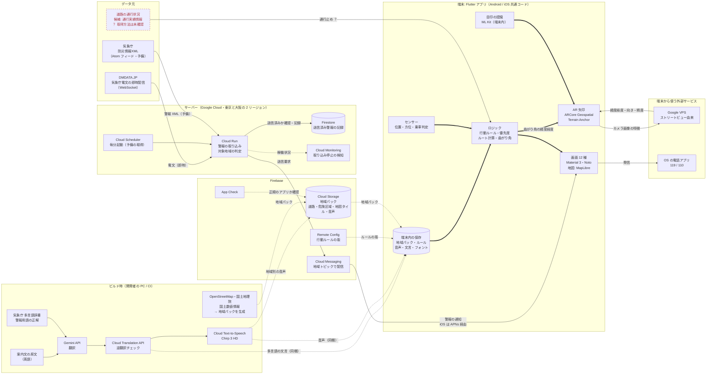
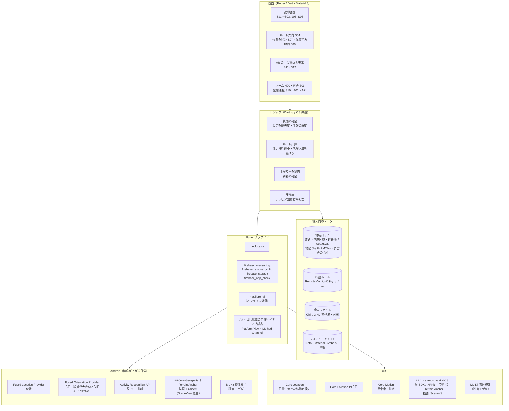
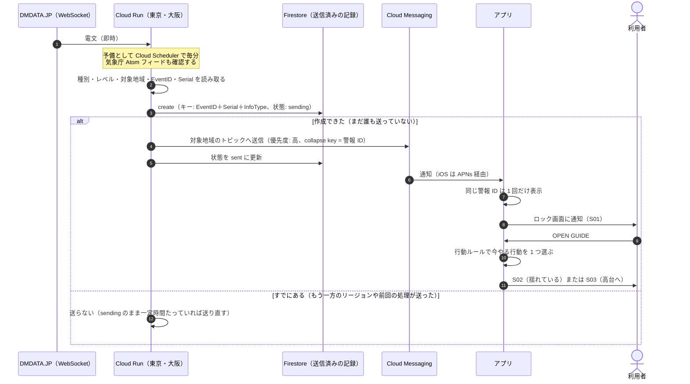
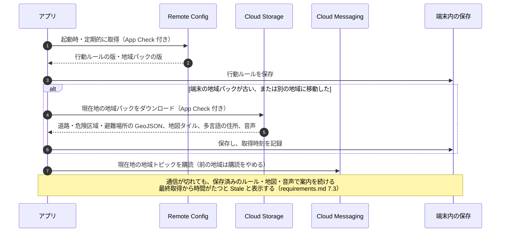
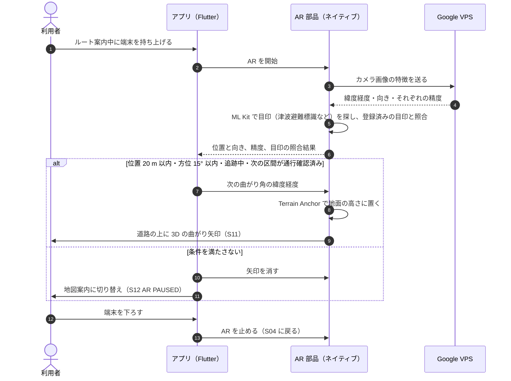
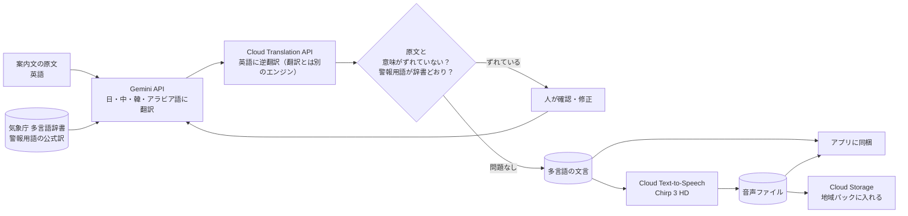
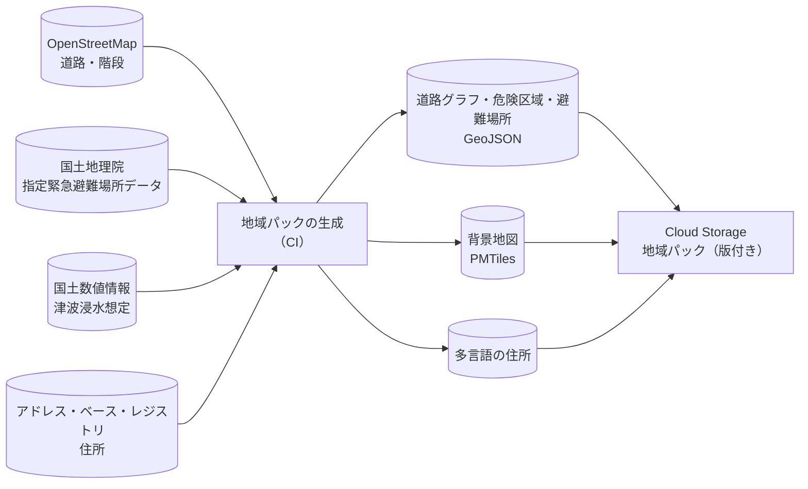
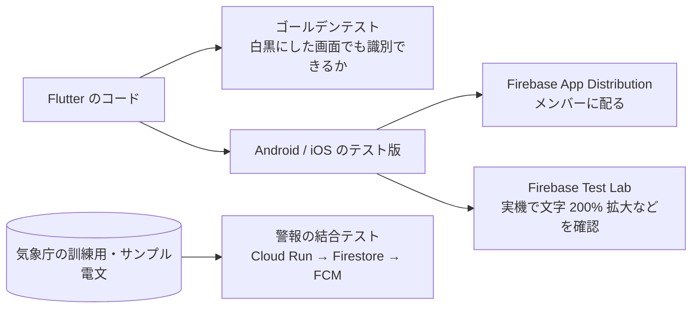

# TASUKU 本番版 システム構成

- ステータス: **ドラフト**（決定事項は「[8. 決定事項](#8-決定事項)」、未決事項は「[9. 未決事項](#9-未決事項)」）
- 作成日: 2026-11-08
- 前提: 今の `mocks/evacuate/` は画面と動きを HTML で再現したモック（[requirements.md](requirements.md)）。本書は、それを Flutter と Google の技術で作り直すときの構成をまとめる
- Google の技術を基本にする。ただし、Google に代わりがないもの・規約上使えないもの（警報の即時配信、オフラインで持てる地図、公的な防災データ）は他社サービスや公的データを使う（8 節 D1〜D5）

---

## 1. 全体構成図



**線の見方**

| 線 | 意味 |
|---|---|
| 実線 `→` | その場で通信が必要な流れ。通信が切れると止まる |
| 点線 `⇢` | 平常時に取得、またはビルド時にアプリへ同梱しておくもの。通信断でも端末の中にある |
| 太線 `⇒` | 端末の中だけで完結する流れ。通信なしで動く |
| 赤の点線枠・「？」 | 技術が決まっていない部分（9 節） |

通信が切れても「行動ルール・地図・ルート計算・音声・目印の認識」はすべて端末の中にあるので、案内は止まらない。止まるのは「新しい警報の受信」「AR の位置合わせ」「通行止めの反映」だけで、そのときは画面に `Stale` / `Route unverified` / `AR PAUSED` を出す（requirements.md 7.3、6.4.1）。

**アプリの位置づけ**: 地震・津波の第一報は、OS の緊急速報（Android / iOS の緊急速報メール・ETWS）が届ける。TASUKU は、第一報を受けた人が「次に何をするか」を母語で案内する補助のアプリとする（D10）。

---

## 2. 端末の中の構成



| 用途 | Android | iOS |
|---|---|---|
| 位置 | Fused Location Provider（geolocator が自動で使う） | Core Location |
| 方位 | Fused Orientation Provider | Core Location の方位 |
| 乗車中・静止の判定（揺れている間は「車内で待つ」、揺れがおさまったら「車を降りて」、高台では「Stay here」） | Activity Recognition API | Core Motion |
| AR の位置合わせ | ARCore Geospatial（VPS）＋Terrain Anchor | ARCore Geospatial（iOS 版 SDK）＋Terrain Anchor |
| AR 矢印の 3D 描画 | Filament（SceneView 経由） | SceneKit |
| 目印の認識（D14） | ML Kit 物体検出＋独自モデル（端末内） | ML Kit 物体検出＋独自モデル（端末内） |
| 地図の表示（D2） | MapLibre＋PMTiles（端末内） | MapLibre＋PMTiles（端末内） |
| 通知（D10） | FCM。重要度「高」の通知チャンネル＋全画面通知 | FCM（APNs 経由）。Critical Alerts（Apple に申請） |
| 地域トピックの購読し直し（D11） | 位置の定期取得 | 大きな移動の検知（significant location change） |
| 読み上げ対応 | TalkBack | VoiceOver |

- 画面・ロジック・データは両 OS で同じ Dart のコード。OS ごとに分かれるのはいちばん下の段だけ
- AR はカメラ映像と 3D 描画をネイティブ側で行い、Flutter の画面に Platform View として埋め込む。`Right 12 m` のカードや下部の地図など、上に重ねる表示は Flutter で描く
- ARCore Geospatial の公式 Flutter プラグインはないため、AR 部分は Android（Kotlin）と iOS（Swift）でそれぞれ書き、Method Channel で Dart とつなぐ

---

## 3. 主な処理の流れ

### 3.1 警報が届くまで



- 通知には警報の種別・レベル・対象地域・発表時刻だけを入れ、表示する文言は端末の中の多言語データから選ぶ（サーバーで文を作らない）
- ログインがないので、端末は現在地の地域コードのトピックを購読して受け取る（D11）
- 二重に届く方が、届かないよりよい。そのため「記録してから送る」順にし、途中で落ちた分は送り直す。二重に送ってしまっても、アプリが警報 ID で 1 回にまとめる（D6）
- Firestore に届かないとき（東京リージョンの障害など）は、記録なしで送る。重複はアプリ側で消す（D7）
- 誘導画面を表示したら、その画面の指示の音声（同梱の Chirp 3 HD）を自動で再生する（requirements.md F18）。TalkBack / VoiceOver が動いているときは、画面の読み上げと重ならないようにする
- 乗車中に揺れを検知したら、S02 は「停車。車内で待つ。」を出し、揺れがおさまってから「車を降りて、歩いて避難。」に切り替える（requirements.md F17）

### 3.2 平常時の事前ダウンロード



### 3.3 AR 案内



- 閾値はモックと同じ値（requirements.md 6.4.1）。実機で調整する
- VPS はストリートビューの画像と照合するので、津波や倒壊で街並みが変わった場所では位置が合わない。そのときは S12 に切り替わり、地図と行動案内で続ける（D16）

---

## 4. ビルド時の流れ

### 4.1 翻訳と音声



- 翻訳と音声は**ビルド時に一度だけ**作る。実行時には AI に文を作らせない
  - 通信が切れても、同じ文・同じ音質で案内できる
  - 誤訳や危ない言い回しを、配る前に止められる
- 逆翻訳は翻訳と別のエンジンで行う。同じモデルだと間違いの傾向も同じになり、ずれを見逃しやすい（D12）
- 「津波警報」「大津波警報」などの警報用語は、気象庁の多言語辞書の訳を正とする（D12）
- 中国語・韓国語・アラビア語は、配る前にネイティブの確認を入れる（モックでは未実施。requirements.md 6.6）

### 4.2 地域パック



- Google Maps Platform の地図・ルート・住所の結果は、規約上、端末やファイルに長く保存して配れない。地域パックには入れない（D2、D13）
- 背景地図は PMTiles（地図タイルを 1 ファイルにまとめた形式）で地域パックに入れ、MapLibre で表示する
- データの出典表示（OpenStreetMap など）を、アプリの情報画面に入れる

---

## 5. データの版管理

「警報」「行動ルール」「地域データ」は更新の頻度も責任者も違うので、別々に配って別々に版を持つ。

| データ | 配る仕組み | 更新のきっかけ | 端末での扱い |
|---|---|---|---|
| 警報 | DMDATA.JP（予備: 気象庁 Atom フィード）→ Cloud Run → Cloud Messaging | 気象庁の発表（即時。予備は毎分確認） | 受け取ったら即座に画面を切り替える。同じ警報 ID は 1 回だけ |
| 行動ルール（優先度・文言の対応） | Remote Config | ルールの見直し時 | 起動時に取得・保存。取れなければ前の版で動く |
| 地域パック（道路・危険区域・避難場所・地図タイル・住所・音声） | Cloud Storage for Firebase | 地域データの更新時 | 版が新しければダウンロード・保存 |
| 文言・音声の基本セット | アプリに同梱 | アプリの更新時 | 通信がなくても必ずある |

---

## 6. モックとの対応

| モック（`mocks/evacuate/src/`） | 本番 |
|---|---|
| `state/derive.ts`（`deriveMode()`・`resolveScreen()`・優先度・鮮度） | Dart に移植。判定の条件は同じ |
| `logic/route.ts`（ダイクストラ・体力消耗・階段・危険区域） | Dart に移植。道路グラフは地域パックの GeoJSON（OpenStreetMap 由来）から作る |
| `logic/nav.ts`（曲がり角・到着の判定） | Dart に移植 |
| `data/alerts.ts`、デモパネルの警報操作 | DMDATA.JP / 気象庁 XML → Cloud Run → Cloud Messaging |
| `data/town.ts`（架空の町） | 地域パックの GeoJSON（Cloud Storage） |
| `data/landmarks.ts`（目印と認識結果） | 地域パックの目印データ＋ML Kit の端末内認識 |
| `components/TownMap.tsx`（自前の SVG 地図） | MapLibre＋地域パックの PMTiles |
| `i18n/`（5 言語の文言・RTL） | Flutter の多言語対応（文言は Gemini で翻訳し、別エンジンで確認したもの） |
| `platform/speech.ts`（Web Speech API） | 同梱の音声ファイル（Chirp 3 HD）を再生 |
| `platform/vibrate.ts`（Vibration API） | OS の振動 |
| `platform/orientation.ts`（DeviceOrientation で傾き） | 端末の傾きセンサー＋方位は Fused Orientation Provider / Core Location |
| `screens/_arScene.tsx`（静止画＋SVG 矢印） | ARCore Geospatial＋Filament / SceneKit |
| `localStorage`（言語設定など） | 端末のローカル保存 |
| `demo/DemoPanel.tsx` | 本番には入れない（テスト用に残すかは別途） |

---

## 7. 開発・テスト・運用



- 警報の取り込みは、気象庁が公開している訓練用・サンプルの電文で結合テストする（D17）
- Cloud Monitoring で「警報の取り込みが 5 分間成功していない」「DMDATA.JP との接続が切れたまま」を検知し、チームに通知する（D8）
- Cloud Scheduler から Cloud Run を呼ぶときは OIDC トークンで認証し、外から呼べないようにする。Remote Config と Cloud Storage には App Check を付ける（D9）

---

## 8. 決定事項

2026-11-08 のアーキテクチャレビューの結果。

### 8.1 技術の選び方

| # | 論点 | 決定 | 理由 |
|---|---|---|---|
| D1 | Google の技術を使う範囲 | Flutter、ARCore Geospatial（VPS）、Cloud Messaging、Remote Config、Cloud Storage、ビルド時の Gemini と Chirp 3 HD はそのまま使う | AR はどの方式でもネイティブで書くので、Flutter で困らない。VPS はストリートビュー由来で、日本の市街地を広くカバーしている。他社の VPS はスキャン済みの場所しか使えない |
| D2 | 地図・ルートのデータ | 道路は OpenStreetMap、ルートは自前のダイクストラ（モックと同じ）。背景地図は MapLibre＋PMTiles を地域パックに入れる | Google Maps Platform は、地図やデータを端末に長く保存すること（オフライン保存）を規約で認めていない。Routes API は、オフライン・危険区域の回避・体力消耗の最小化に対応していない |
| D3 | 危険区域・避難場所のデータ | 国土地理院の「指定緊急避難場所データ」と国土数値情報の津波浸水想定を使い、ビルド時に GeoJSON にする（4.2） | 公的データで、出どころを説明できる。モックの架空の町と同じ形にできる |
| D4 | 警報の取得元 | **DMDATA.JP の WebSocket**（気象庁電文の即時配信）を主にする。気象庁の防災情報 XML（Atom フィード）を Cloud Scheduler で毎分確認し、予備にする | Atom フィードを毎分取りに行くだけでは、津波警報でも最大 1〜2 分遅れる。WebSocket ならすぐ届く。DMDATA.JP が止まっても、予備で受け取れる |
| D5 | 緊急地震速報 | アプリの対象外。OS の緊急速報（ETWS）に任せる。S02「揺れている」は、緊急速報や揺れを受けてアプリを開いた人への案内とする | 緊急地震速報は数秒が勝負で、サーバーから FCM で配る経路では間に合わない |

### 8.2 サーバー

| # | 論点 | 決定 | 理由 |
|---|---|---|---|
| D6 | 送信済み警報の記録（旧・未決 #3） | **Firestore** を使う。キーは `EventID`＋`Serial`＋`InfoType`。`create()` で「sending」の記録を作れた処理だけが送り、送ったら「sent」にする。「sending」のまま一定時間たったものは送り直す。古い記録は TTL で消す | `create()` は、同じキーの記録があると失敗する。そのため、二重送信を防ぐ仕組みがそのまま作れる。サーバーの管理がいらず、この量ならほぼ無料枠に収まる。Memorystore や Cloud SQL は大げさすぎる。キーに `Serial` と `InfoType` を入れるのは、続報・訂正・取り消しを別の警報として扱うため |
| D7 | サーバーの冗長化 | 警報を取り込む Cloud Run を、東京（asia-northeast1）と大阪（asia-northeast2）の両方で動かす。重複は D6 の記録で防ぐ。Firestore に届かないときは記録なしで送り、アプリ側で重複を消す | 日本の大災害では、東京リージョン自体が影響を受けるおそれがある。避難の警報では、二重に届く方が届かないよりよい |
| D8 | 監視 | Cloud Monitoring で、取り込みが 5 分間成功していないことと、DMDATA.JP との接続が切れたままのことを検知し、チームに通知する | 警報が止まっても、誰も気づかないのが最も危ない |
| D9 | セキュリティ | Cloud Scheduler から Cloud Run への呼び出しは OIDC で認証する。Remote Config と Cloud Storage には App Check を付ける | 警報を送る入り口を、外から呼ばせない。地域パックを正規のアプリにだけ配る |

### 8.3 アプリ

| # | 論点 | 決定 | 理由 |
|---|---|---|---|
| D10 | 通知の重要度 | iOS は Critical Alerts を Apple に申請する（マナーモードでも鳴らすため）。Android は重要度「高」の通知チャンネルと全画面通知を使う。第一報は OS の緊急速報が届け、アプリは補助と位置づける | FCM のトピック配信はベストエフォートで、大量に配信するときは遅れることがある |
| D11 | ログインなしでの地域別の通知（旧・未決 #4） | 地域コードごとにトピックを分ける方式にする。地域が変わったら、前の地域の購読をやめて新しい地域を購読し、地域パックも取り直す。地域が変わったことは、Android では位置の定期取得、iOS では大きな移動の検知（significant location change）で気づく | iOS では、バックグラウンドで常に位置を取ることが難しい。大きな移動の検知なら、電池をあまり使わずに起こしてもらえる |
| D12 | 翻訳の確認 | 逆翻訳は Cloud Translation API で行う（翻訳の Gemini とは別のエンジン）。警報用語は気象庁の多言語辞書の訳を正とする | 同じモデルで逆翻訳すると、間違いの傾向も同じになり、ずれを見逃しやすい |
| D13 | 住所の多言語表示（旧・未決 #5） | 地域パックに多言語の住所を持たせる。元データはアドレス・ベース・レジストリなどの公的データにする | 通信が切れても使える。Google の Geocoding の結果は、規約上、保存して配れない |
| D14 | 目印の認識（旧・未決 #1） | ML Kit の物体検出に、津波避難標識などを学習させた独自モデルを載せ、端末の中で認識する。実行時に Gemini は使わない | 通信が切れても動き、反応も速い。「実行時に AI に文を作らせない」方針とも合う |
| D15 | フォント（旧・未決 #6） | Noto をアプリに同梱する（`google_fonts` の実行時取得は使わない） | 通信が切れても文字化けしない |
| D16 | 被災後の VPS | 街並みが変わった場所では VPS が使えない前提にする。S12（地図案内）に切り替えて続ける | VPS はストリートビューの画像と照合するため |
| D17 | 警報のテスト | 気象庁の訓練用・サンプル電文で、Cloud Run → Firestore → FCM の結合テストを行う | 本物の警報を待たずに、続報・訂正・取り消しまで確かめられる |

---

## 9. 未決事項

| # | 論点 | 内容 |
|---|---|---|
| 1 | 通行止め情報（F33） | 候補は ITS Japan の通行実績情報（災害時に公開）、JARTIC（日本道路交通情報センター、有料）、国交省の道路情報。どれも、アプリから機械的に取得できるか（API・利用条件）がまだ確認できていない。決まるまでは `Route unverified` を出す |
| 2 | DMDATA.JP の契約 | 費用・利用規約・同時接続数を確認する（D4） |
| 3 | Critical Alerts の申請 | Apple の審査が通らなかった場合、iOS は通常の通知（time-sensitive）で代わりにするか（D10） |
| 4 | 地域コードの単位 | トピックを分ける単位（市区町村、気象庁の津波予報区など）を決める（D11） |

---

## 10. ハッカソン実装範囲（2026-11-09 締切）

1〜9 節は本番の構成。ハッカソンの締切（2026-11-09 24:00）までに作るのは、その一部だけにする。**実装はこの節に従い、ここから外れる変更は、理由をこの節か PR に書いてから行う。**

### 10.1 作るもの

| # | 作るもの | 置き場所 | 対応する決定 | 内容 |
|---|---|---|---|---|
| H1 | 警報の取り込みと配信 | `services/alert-ingest/`（Cloud Run、Node.js + TypeScript） | D4 の一部、D6、D17 | 気象庁形式の電文（XML）を受け取り、種別・レベル・予想される高さ・到達予想時刻・対象地域を読み取る。Firestore に `create()` で記録して二重送信を防ぎ（D6）、FCM のトピックへ送る。気象庁のサンプル電文でテストする（D17） |
| H2 | モックへの警報の反映 | `mocks/evacuate/` | D10 の一部 | Firestore の警報を購読して、誘導の状態に反映する（アプリ内の状態はこちらが主）。FCM はロック画面の通知（S01）に使う。Web はトピックを直接購読できないので、モックがトークンを Firestore（`fcmTokens`）に書き、サーバーがトピック送信に加えて全トークンへ multicast する（10.4）。通信できないときは、これまでどおりデモパネルから警報を変える |
| H3 | フィードバック対応 | `mocks/evacuate/` | — | requirements.md 14.7 の「締切までに作るもの」 |
| H4 | AR 案内アプリ | `apps/ar_guide/`（Flutter、Android） | D1 の一部 | AR 画面（S11）だけのアプリ。ARCore の平面検出で、床に曲がり矢印を置く。曲がる方向と距離は、モックからディープリンクで受け取る。**（2026-11-10 追記）** PR #18〜#20 で、モックの全画面・デモパネル・音声・Firestore / FCM をこのアプリに移し、提出物の本体にした。AR はデモ端末が ARCore 非対応のため、カメラ＋コンパス方式を主にした |
| H5 | Web の AR の代わり | `mocks/evacuate/`（S11） | F3C | カメラ映像（`getUserMedia`）にコンパスの向きに合わせた矢印を重ねる。iPhone と、H4 が動かない場合の代わり |
| H6 | 多言語の音声 | `tools/voice/`（ビルド時のスクリプト） | D1 の一部 | Chirp 3 HD で、誘導画面の指示を 5 言語の音声ファイルにしてモックに同梱する。Web Speech API は音声ファイルがないときの代わりにする |
| H7 | 訳の点検 | `tools/i18n-check/`（ビルド時のスクリプト） | D1 の一部、D12 | アプリの誘導の文と警報の用語を、英語の原文から Gemini で訳し直し、Cloud Translation API で英語に逆翻訳して、現在の訳と比べる（逆翻訳は API が無効のため現時点では未実施）。結果は `docs/i18n-review.md`。報告だけで、アプリの文は人が直す |

### 10.2 意図的に外すもの

| 本番の構成 | ハッカソン版 | 理由 |
|---|---|---|
| Flutter のアプリ一式（D1） | Web のモック＋AR だけの Flutter アプリ（**2026-11-10 追記**: その後、全画面を Flutter の Android アプリに移した。iOS は対象外で、iPhone は Web のモックで代用） | 締切までに全画面を作り直せない。モックはすでに一連の流れが動く |
| ARCore Geospatial（VPS）での位置合わせ（D1） | ARCore の平面検出のみ（実装ではカメラ＋コンパス方式を主にし、平面検出は対応端末だけ） | 会場は屋内の可能性が高く、VPS は屋外でしか使えない。デモの町は架空 |
| 東京・大阪の 2 リージョン（D7） | 東京（asia-northeast1）だけ | デモには不要。設計上は D6 の記録で重複を防げるので、後から増やせる |
| DMDATA.JP の WebSocket（D4） | 気象庁形式のサンプル電文を、認証付きのエンドポイントへ送る | 契約が未決（9 節の 2）。電文の形は同じなので、受け口だけ差し替えればよい |
| Cloud Scheduler・Monitoring（D8・D9） | なし | デモには不要 |
| 地域トピック（D11） | デモ用の 1 トピック（`demo-minato-bay`） | 架空の町なので地域は 1 つ |

### 10.3 守ること

- **公開しない**: Cloud Run は未認証の呼び出しを許可しない。電文は ID トークン付きで送る（デモではスクリプトから送る）
- **秘密情報をリポジトリに入れない**: このリポジトリは private（2026-11-09 に public から変更）なので、コードは外部からは見えない。それでも、あとで公開する可能性や漏えいに備えて方針は変えない。サービスアカウントの鍵は作らない。Firebase の Web 用の設定値（API キーなど）は公開を前提にした値なので入れてよいが、それ以外は Secret Manager に置く
- **費用**: Cloud Run は最小インスタンス 0、最大インスタンス 2。予算アラートは 3,000 円
- **ブランチ**: `develop` から feature ブランチを切り、PR を出す。コードの PR は、実装とは別のレビュアーが確認してからマージする
- **統合ブランチへの直接 push を防ぐ**: GitHub の無料プランでは private リポジトリのブランチ保護（ルールセット）が効かない。そのため `main` / `develop` への直接 push は、(1) エージェントのシェルのガード（`.claude/hooks/`）で事前に止め、(2) 監視役が事後に `git log --first-parent` で統合ブランチの履歴が PR のマージコミットだけかを確認する、の 2 段で防ぐ。直接 push が見つかったら、その変更を PR に出し直す
- **Firestore のルール**: 警報のコレクションは誰でも読めるが、書けるのはサーバー（Cloud Run のサービスアカウント）だけにする。Web の FCM トークン（`fcmTokens`）は、クライアントが自分のトークンを新しく作ることだけを許し（2 日以内に切れる `expireAt` を必須にする）、読む・変える・消すはサーバーだけにする

### 10.4 H2 の構成（モックへの警報の反映）

```
alert-ingest ─┬─ Firestore alerts/{EventID} ──onSnapshot──▶ モック（store に反映。アプリ内の状態はこちらが主）
              ├─ FCM トピック demo-minato-bay（本番のアプリ用。Web は購読できない）
              └─ FCM sendEachForMulticast ──▶ fcmTokens の全トークン ──▶ Service Worker がロック画面に通知（S01）
モック ── 通知の許可 → getToken（VAPID 鍵）→ Firestore fcmTokens/{自動 ID} に create（expireAt 付き。開くたびに登録し直す）
```

- **アプリ内の状態は Firestore の購読で決める**: FCM はベストエフォートで、フォアグラウンドでは表示されず、iPhone の Safari では受けられない。そのため、誘導の状態は `alerts/{EventID}`（最新の状態）の購読で更新し、FCM は画面を閉じているときの通知（S01）だけに使う。フォアグラウンドで受けた FCM（`onMessage`）は、Firestore と重複するので表示しない
- **Flutter アプリの再通知**: Flutter アプリは、前面にないとき（paused / hidden / detached）に FCM が有効なら、FCM の通知と重複するのでアプリ内の再通知（F88 / F89 の振動と通知）を出さない。inactive は FCM と同じく前面として扱う。FCM が使えない・有効でないときは再通知する。Web はこの抑止をしない
- **トークンを Firestore に置いて multicast する理由**: Web の FCM SDK には、クライアントからトピックを購読する API がない（トピックの購読はサーバーの Admin SDK / Instance ID API でしかできない）。トピックに登録するサーバーの受け口を新しく作ると、未認証の公開エンドポイントが増える（10.3 の「公開しない」に反する）。そこで、モックが自分のトークンを Firestore の `fcmTokens` に書き（ルールで create だけを許す）、alert-ingest がトピック送信に加えて有効なトークンへ `sendEachForMulticast` で送る。無効になったトークンは送信の結果を見て削除する。Firestore に届かないとき（D7 の記録なしの経路）は、トピックだけに送る本番のアプリ（Flutter）はトピックを購読できるので、この経路はハッカソン版の Web のためだけのもの
- **偽のトークンへの備え**: `fcmTokens` は公開の Web 設定だけで誰でも書けるので、偽のトークンを大量に書かれると、サーバーが読む件数の上限から本物が押し出されるおそれがある。App Check は使わず、(1) 登録は 2 日以内に切れる（`expireAt`、TTL）、(2) モックは開くたびに新しいドキュメントとして登録し直す、(3) サーバーは有効期限内のものだけを新しい順に最大 200 件読み、形式の誤り（`invalid-argument`）や登録の切れたトークンを削除する、で抑える。偽の登録が残るのは最長 2 日で、本物は開くたびに新しい側に入る
- **反映の規則**: 電文（EventID＋Serial＋InfoType）ごとに 1 回だけ、デモパネルの警報操作と同じ形（津波の警報を置き換える・解除）で store に反映する。格上げ・引き上げ・格下げの判定と帯（FB3）は store がこれまでどおり行う。購読を始めたときにある警報は、60 分以内に書かれた発表中の警報だけを反映し、それより古いものや解除済みのものは「見た」ことにするだけにする（シナリオを上書きしないため）。シナリオのリセットで受信した状態は消え、そのときの最新の電文は再び反映しない
- **通信できないとき**: 購読を OFF にしたとき、購読が失敗したとき、デモパネルで「オフライン」にしたときは、これまでどおりデモパネルだけで警報を操作できる。デモの「オフライン」の間に届いた電文は、オンラインに戻ったときに反映する。Firebase の SDK は必要になってから読み込むので、読み込みに失敗してもモックの他の動作は止まらない
- **iPhone**: Web Push はホーム画面に追加した PWA でしか受けられない。このモックは PWA にしていないので、iPhone では Firestore の購読だけで動かし、通知のボタンは「非対応」と表示する
