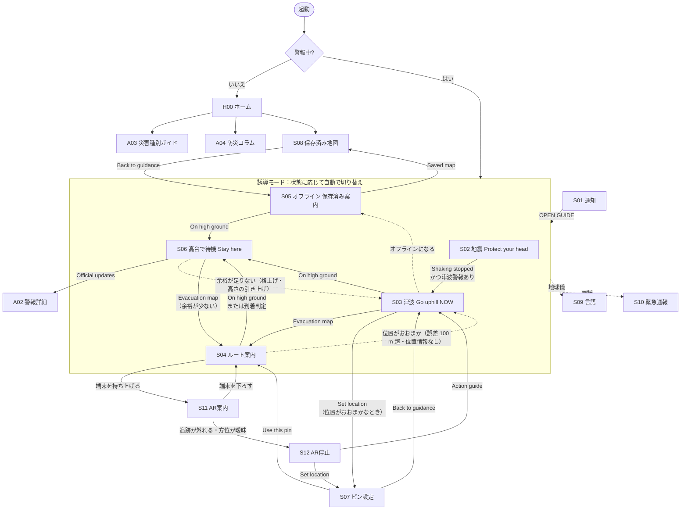

# TASUKU 動くモック 要件定義（レビュー用ドラフト）

- ステータス: **レビュー済み・実装中**（決定事項は「[12. 決定事項](#12-決定事項)」、フィードバックによる修正要件は「[14. フィードバック対応](#14-フィードバック対応2026-11-08)」）
- 作成日: 2026-11-08
- 対象ブランチ: `mock/evacuate`
- 本番（Flutter・Google の技術）での構成: [architecture.md](architecture.md)
- 元資料: 画面デザイン 11 枚（[images/screen-*.png](images/)）、AR のデモガイド（[images/demo-guide-04-ar.png](images/demo-guide-04-ar.png)）、機能一覧 7 枚（[images/features-*.png](images/)）

---

## 1. プロダクト概要

**TASUKU** は、日本を訪れた外国人旅行者向けの災害時避難誘導アプリ。

- 登録・ログインなしで使える
- 気象庁（JMA）の情報をもとに、**今やるべき行動を、短い言葉とピクトグラムで 1 つだけ**示す
- 地震 → 津波のように災害が重なっても、優先すべき行動を自動で判断して切り替える
- 体力消耗が少なく、危険区域を避けたルートで高台・避難場所へ案内する
- オフラインでも、保存済みの行動案内と地図を出す（情報が古いときはそう明示する）
- 母語で表示し、地名には日本語を併記する（救助を求めるときに日本人に見せられる）

## 2. モックの目的とスコープ

### 目的
ハッカソンのデモ・審査で、**実際に触って一連の避難体験が通しで動く**ことを見せる。

### 方針
| 項目 | 方針 |
|---|---|
| 動作環境 | ブラウザ。PC ではスマホ枠（390×844 相当）の中に表示し、横にデモ操作パネルを出す。スマホ実機では全画面表示 |
| 外部 API | **接続しない**。気象庁・GPS・道路状況・地図はすべてモックデータで再現する |
| 舞台 | 架空の町「みなと湾（Minato Bay）」。海・危険区域・高台・避難場所を持つ簡易な地図 |
| 時刻 | デモ用の仮想時計（初期値 09:41 JST）。デモパネルで進められる |
| 表示 | 全画面右上に `DEMO` バッジを常時表示（実際の警報と誤認させないため） |
| 実データ | 本物の警報・住所・避難場所は使わない。住所には「（架空）」を付ける |

## 3. 技術方針（提案）

| 項目 | 提案 | 理由 |
|---|---|---|
| フレームワーク | Vite + React + TypeScript | 画面数・状態遷移が多く、コンポーネント化したい |
| スタイル | CSS Modules または素の CSS（デザイントークンを CSS 変数で定義） | 依存を増やさない |
| 地図 | 自前の SVG（タイル地図は使わない） | オフラインで動き、デザイン画像の見た目を再現しやすい |
| ピクトグラム | 自前の SVG で描き起こす | 画像の見た目に合わせ、色を差し替えられる |
| 音声 | Web Speech API（`speechSynthesis`） | 「Listen」・曲がり角の音声案内 |
| 振動 | Vibration API（`navigator.vibrate`）＋画面上の振動アイコン表示 | iOS Safari は非対応なので見た目でも示す |
| 保存 | `localStorage`（言語設定・最終取得時刻） | 「端末の設定ファイル」の代わり |
| オフライン | デモパネルの「オフライン」トグルで再現。余力があれば Service Worker で実際にオフライン起動も可能にする | |
| ディレクトリ | `mocks/evacuate/`（アプリ本体）、`mocks/evacuate/docs/`（本書） | |

### デザイントークン（画像から抽出した目安）
| 用途 | 色 |
|---|---|
| 背景（ダーク） | `#18161A` |
| ボタン（ダーク） | `#2A272C` |
| 警報レッド | `#AE1428` |
| 高台待機（落ち着いた赤） | `#7A001B` |
| 強調イエロー | `#FFD54F` |
| ピクトグラム背景 | `#FCE8E4` |
| ピクトグラム線 | `#1B2B2E` |
| ライト背景（言語・緊急通報） | `#FDF6F1` |
| 地図: 海 / 陸 / 危険区域 / 経路 | `#BAD3E6` / `#E8E8E0` / `#F0C4BC`＋斜線 `#A8323A` / `#1A4F9C` |

フォント: 見出しは極太の丸みのあるサンセリフ（候補: Nunito 900 / M PLUS Rounded 1c 800）、本文は Noto Sans（JP / SC / KR / Arabic）。

---

## 4. 画面一覧

画像がある画面（S01〜S12）はデザインをそのまま再現する。画像がない画面（H, A 系）は同じデザイン言語で新規に作る。

| ID | 画面 | 画像 | 主な要素 | 優先度 |
|---|---|---|---|---|
| S01 | ロック画面のポップアップ通知 | [01](images/screen-01-lock-alert.png) | 時計、`SIMULATED ALERT`、災害名（EARTHQUAKE + TSUNAMI）、ピクトグラム、一言指示、`OPEN GUIDE` | P0 |
| S02 | 地震・揺れている最中 | [02](images/screen-02-earthquake-indoors.png) | バッジ `EARTHQUAKE / INDOORS`、頭を守るピクト、`Protect your head`、`Listen`、`Shaking stopped`、出典行（JMA・時刻・Details） | P0 |
| S03 | 津波警報・即時避難 | [03](images/screen-03-tsunami-warning.png) | バッジ `TSUNAMI WARNING`、高台へ走るピクト、`Go uphill. NOW`、`Evacuation map`、`Listen`、`On high ground` | P0 |
| S04 | ルート案内（ナビ） | [04](images/screen-04-route-nav.png) | 大きな曲がり矢印、`Right` / `40 m`、音声・振動の状態アイコン、ミニ地図（危険区域斜線・経路・現在地・避難先旗）、凡例、`On high ground`、`Passability checked 09:41 JST` | P0 |
| S05 | オフライン・保存済み案内 | [05](images/screen-05-offline-guide.png) | バッジ `OFFLINE / SAVED GUIDE`、背景がグレー、`Go uphill.`、`TSUNAMI GUIDE`、`Route unverified`、`Saved map`、`Last alert 09:40 JST • Stale` | P0 |
| S06 | 高台に到着・待機 | [06](images/screen-06-high-ground.png) | バッジ `TSUNAMI WARNING ACTIVE`、待機ピクト（一時停止マーク）、`Stay here.` / `HIGH GROUND`、根拠のカード（標高・予想される津波の高さ・`21 m above forecast`・`Stay until the warning is lifted`、14.3）、`Listen`、`Official updates`、`JMA • Warning active` | P0 |
| S07 | 位置が不確か・ピン設定 | [07](images/screen-07-location-uncertain.png) | バッジ `LOCATION UNCERTAIN`、`Set a pin`、`GPS accuracy ±180 m`、誤差円つき地図、ドラッグできるピン、`Use this pin`、`Back to guidance`、`Route guidance paused`。**手動で開くときだけ**出す（`Set location` / `Choose on map`、14.5） | P0 |
| S08 | 保存済み地図（オフライン） | [08](images/screen-08-saved-map.png) | バッジ `OFFLINE`、大きな地図（危険区域・避難先旗）、凡例、`Back to guidance`、`Live road status unavailable` | P0 |
| S09 | 言語設定 | [09](images/screen-09-language.png) | English / 日本語 / 简体中文 / 한국어 / العربية、`Apply` | P0 |
| S10 | 緊急通報 | [10](images/screen-10-emergency.png) | Ambulance 119 / Fire 119 / Police 110、`Show this location`（母語＋日本語の住所）、`Opens the system dialer` | P0 |
| H00 | ホーム（平常時） | なし | 「警報なし」の状態表示、災害種別ごとのガイドボタン、保存済み地図、コラム、最終更新時刻 | P0（起動の振り分けに必要なので最小限で作る） |
| A01 | 位置情報の許可説明 | なし | 何に使うかの説明、`Allow` / `Choose on map` | P1 |
| A02 | 警報の詳細（Details / Official updates） | なし | 発表元・種別・レベル・対象地域・発表時刻の時系列 | P1 |
| A03 | 災害種別ガイド（平常時に見る行動案内） | なし | 地震（屋内・屋外・車内）、津波 などのピクトと一言 | P1 |
| A04 | 防災コラム | なし | 日本の防災制度（警報レベル、避難所、119/110 など）の記事一覧と本文 | P1 |
| S11 | AR 案内（カメラ＋地図） | [11](images/screen-11-ar-guidance.png) | ヘッダー `AR guidance`、カメラ映像（デモでは架空の街路の静止画）、`TSUNAMI WARNING`、`Right` / `12 m` カード、道路に重なる黄色の曲がり矢印、下部シート `MAP`（目的地 `Hill Park / 高台公園`、黄色の経路、向き付き現在地）、`Striped = hazard`、音声ボタン | P0 |
| S12 | AR 停止時（地図案内） | [デモガイド 14](images/demo-guide-04-ar.png) | ヘッダー `Map guidance`、バッジ `AR PAUSED`、`Check location` / `Camera position uncertain`、地図（経路は出さない）、`Set location`、`Action guide`、`Route arrows hidden` | P0 |

**優先度**: P0 = デモに必須 / P1 = 機能一覧にあり、時間があれば作る / P2 = 見た目だけのダミーにとどめる、または作らない

### 全画面共通
- 上部: 時刻（仮想時計）と `DEMO` バッジ
- ヘッダー: 誘導系画面はロゴ `TASUKU`、サブ画面は戻る `←` ＋画面名。右に言語（地球儀）と緊急通報（電話）ボタンを**常に**置く
- 誘導系画面の構成は「状態バッジ → ピクトグラム → 一言の指示 → 主ボタン → 副ボタン → 音声ボタン → 出典・鮮度の行」で統一する
- 音声ボタン（`Listen`）は誘導画面（S02〜S06、S11、S12）のすべてで同じ形にし、出典行の直上の左端（RTL では右端）に置く。S11 は下部シート（`MAP`）の上端の左。読み上げ中は `Stop` に変わる（F80〜F82）
- 警報が格上げ・格下げされたら、誘導画面のヘッダーの下に帯（`UPGRADED: …` など）を出す（F88〜F8A）
- 押せる場所は最小 56px 以上の大きなボタンにする

---

## 5. 画面遷移

モックでの補足（実装上の差分）:
- S07 は**自動では出さない**（14.5、F90）。開くのは S03 / S05 の `Set location`（位置がおおまかなとき）、S12 の `Set location`、A01 の `Choose on map` だけ。`Back to guidance` で元の案内に戻る（位置がおおまかなままなら S03 / S05、そうでなければ S04）。S07 を表示している間は歩行シミュレーションを止める
- 位置がおおまか（誤差 100 m 超）または位置情報がないときは、ルート案内（S04 / S11 / S12）を出さず、S03（オフラインなら S05）に `Follow the blue evacuation signs` と `Set location` を出す（F92、F94）。歩行シミュレーションは止めず、位置が戻れば S04 に戻る
- ルート案内（S04）を始める時点で位置情報の許可が未確認なら、先に A01 を出す。`Allow` で S04、`Choose on map` で S07 を開く（F24）
- 図の `S06 -. 余裕が足りない .-> S03` は、14.3 の判定が「足りない」に**確実に**なったとき（位置がおおまかなら誤差円内の最高標高でも足りないとき。指定避難場所にいる場合を除く）。`Go higher. NOW` を出し、今いる場所からルートを引き直す。自動で戻すのは条件が新たに成り立ったときの 1 回だけで、次に判定し直すのは格上げ・高さの引き上げ・位置が確かになったときに限る（14.7 の 6）

---

## 6. 機能要件

機能一覧の各行を「モックでどう実現するか」に落とし込んだもの。

### 6.1 警報の取得と表示
| ID | ユーザーから見た機能 | 裏側（本番想定） | モックでの実現 | 優先度 | 画面 |
|---|---|---|---|---|---|
| F01 | 災害名が表示される | 気象庁の API から警報を取得 | `alerts.json` の内容をシナリオに応じて読み込む | P0 | S01〜S06 |
| F02 | 危険度（注意報・警報・特別警報）が分かる | 警報の種別を取得 | `level: advisory / warning / emergency` をバッジの文言と色に反映 | P0 | S02〜S06 |
| F03 | 現在地が揺れているか分かる | 気象庁と連携し現在地が揺れているか判定 | シナリオの `shakingAtLocation` フラグ。デモパネルで ON/OFF | P0 | S02 |
| F04 | ポップアップ通知が出る | プッシュ通知 | スマホ枠内にロック画面＋通知カード（S01）を表示。可能ならブラウザの Notification API も併用 | P0 | S01 |
| F05 | 起動時、平常時はホーム、警報中は誘導画面が出る | 起動時にどちらを出すか判定 | 起動時に有効な警報があれば誘導モード、なければ H00 | P0 | H00 / 誘導 |
| F06 | 出典と発表時刻が分かる | — | 各誘導画面の下に `JMA • 09:40 JST • Details` | P0 | S02〜S06 |
| F07 | 警報の詳細・続報を見られる | 公式情報の時系列 | `Details` / `Official updates` から A02 を開く | P1 | A02 |

### 6.2 行動案内
| ID | ユーザーから見た機能 | 裏側（本番想定） | モックでの実現 | 優先度 | 画面 |
|---|---|---|---|---|---|
| F10 | 揺れているときは「頭を守る」ピクトグラムが出る | — | S02 | P0 | S02 |
| F11 | 短い単語とアイコンで案内される | — | 一画面に指示は 1 つ。文言は 3 語程度まで | P0 | 全誘導画面 |
| F12 | 注意すべきことが示される | — | 状況バッジ（INDOORS など）と指示文で示す。追加の注意事項は A03 に置く | P0 | S02〜S06 |
| F13 | 災害が重なったとき、優先すべき行動が出る | 重複時の優先度計算 | 7.2 の優先度ルールで表示する行動を決める | P0 | 誘導 |
| F14 | 状況別のピクトグラム（例: 車内で待つ） | — | 地震の状況を `INDOORS / OUTDOORS / IN CAR` で持ち、ピクトと指示を切り替える | P1 | S02 / A03 |
| F15 | 災害種別を選んで案内を見られる | — | H00 の災害種別ボタン → A03 | P1 | H00 / A03 |
| F16 | 「Listen」で指示を読み上げる | 音声ファイル再生 | `speechSynthesis` で現在の言語で読み上げ。ボタンの位置と形は F80〜F82 | P0 | S02〜S06、S11、S12 |
| F17 | 車の中で揺れたら、揺れがおさまるまで車内で待つよう促される | 乗車中の判定（Activity Recognition / Core Motion） | `IN CAR` で揺れている間は S02 に `Pull over. Stay inside.`（停車。車内で待つ。）＋ `Wait until the shaking stops`。揺れがおさまって避難に移ると、S03 / S05 に `Leave the car. Go on foot.`（車を降りて、歩いて避難。）を添える | P0 | S01 / S02 / S03 / S05 / A03 |
| F18 | 画面が切り替わると、その画面の指示が自動で読み上げられる | 同梱の音声ファイルを再生 | 誘導画面（S01〜S03、S05、S06）を表示した 0.3 秒後に、その画面の指示を `speechSynthesis` で読み上げる。S02 の状況切り替えや言語の変更でも読み直す。デモパネルの「画面が切り替わったら読み上げる」で OFF にできる | P0 | S01〜S03 / S05 / S06 |

### 6.3 位置・地図
| ID | ユーザーから見た機能 | 裏側（本番想定） | モックでの実現 | 優先度 | 画面 |
|---|---|---|---|---|---|
| F20 | 現在地がピンで表示される | GPS で現在地を取得 | シナリオで決めた仮の現在地を地図上に表示 | P0 | S04 / S07 |
| F21 | ピンの周り X m が色付けされる（誤差円） | GPS の精度 | 精度（m）に比例した半径の円を描く | P0 | S07 |
| F22 | ピンを置き直せる | — | S07 で地図をタップ／ドラッグしてピンを移動 → `Use this pin` で現在地を確定 | P0 | S07 |
| F23 | 危険な場所が地図上で色付けされる | 既存ハザードマップで危険区域にいるか判定 | 危険区域ポリゴンを斜線で描き、現在地が内側かどうかを判定 | P0 | S04 / S07 / S08 |
| F24 | 位置情報の許可時に用途を説明し、拒否されても地図で現在地を選べる | 許可状態を確認し、拒否なら手動選択に切り替え | A01 を出し、`Choose on map` なら S07 を開く。警報中に位置情報がない場合は S07 を自動では出さず、S03＋標識の案内（F94）。デモパネルで「許可/拒否」を切り替え | P1 | A01 / S07 |
| F25 | 地名・住所が母語と日本語で併記される | GPS の位置から、地域パックに持たせた多言語の住所を引く（architecture.md D13） | 地図上の地点ごとに多言語の住所データを持つ | P0 | S10 |

### 6.4 ルート案内
| ID | ユーザーから見た機能 | 裏側（本番想定） | モックでの実現 | 優先度 | 画面 |
|---|---|---|---|---|---|
| F30 | 地図に避難ルートが色付けされる | 最短（体力消耗最小）かつ危険を避けたルートをオフラインで計算 | 架空の町の道路グラフでダイクストラ法を実行（7.4） | P0 | S04 |
| F31 | 次の曲がり角の方向と距離が大きく出る | 空間分析 | 仮想の現在地から次の曲がり角までの距離と方向を計算 | P0 | S04 |
| F32 | 経路上の注意（例: 階段あり）が出る | — | 経路に階段区間があれば凡例に `Steps on route` | P0 | S04 |
| F33 | 道路が通れるか確認済みの時刻が出る | 道路状況 | `roads.json` の通行止め情報。オンライン時のみ `Passability checked HH:MM JST` | P0 | S04 |
| F34 | 画面を消していても音声と振動で案内される | 画面オフでも曲がり角への接近を判定し、音声と振動を出す | デモパネルの「画面オフ」で画面を暗転させても、歩行シミュレーションは続き、曲がり角の手前で読み上げ＋振動 | P1 | S04 |
| F35 | 高台に着いたら待機に切り替わる | — | `On high ground` を押す、または現在地が避難先から 20 m 以内で S06 へ。S06 では 14.3 の余裕の判定をする | P0 | S06 |
| F36 | 端末を持ち上げたときだけ AR 矢印が出る | 端末の傾きで AR を起動・停止 | 実機では DeviceOrientation（前後の傾き 60° 以上）、PC ではデモパネルのトグル | P0 | S04 / S11 |

### 6.4.1 AR 案内（S11 / S12）
デモガイドの 3 段階（SEE → ALIGN → GUIDE）をモックデータで再現する。

| ID | ユーザーから見た機能 | 裏側（本番想定） | モックでの実現 | 優先度 |
|---|---|---|---|---|
| F37 | カメラ映像の道路に曲がり矢印が重なる | カメラ映像に確認済み経路を重ねる | 架空の街路の静止画に、次の曲がり方向（Right / Left / Straight）に応じた SVG 矢印を重ねる | P0 |
| F38 | カメラと地図で同じ曲がり角を示す | ARCore Geospatial でカメラの位置・向きを照合し、同じ確認済み経路と右折地点を両方に出す | S11 の `Right 12 m` と下部 MAP の経路・現在地は、S04 と同じルート計算・歩行シミュレーションの値を使う | P0 |
| F39 | 目印（青い津波避難標識など）を手がかりに位置を合わせる | 端末内の ML Kit（独自モデル）でカメラ画像から目印の候補を抽出し、登録済みの目印と照合。見つからなければ照合を保留（architecture.md D14） | `landmarks.json` に登録した目印と、シナリオで決めた「認識結果」を照合。デモパネルで「認識枠を表示」にすると、標識に枠と `Landmark matched` を出す。見つからない設定なら照合保留を表示 | P0 |
| F3A | 通行確認済みの区間にだけ矢印を出す | — | 次の区間が通行未確認（オフライン時など）なら矢印を出さない | P0 |
| F3B | 追跡が外れたら AR を止め、地図に戻す | 測位・方位の精度が閾値を下回ったらカメラを停止 | デモパネルの「位置精度」「方位精度」「追跡」を悪化させると S12 へ。位置が曖昧なら地図の経路も隠す（`Route arrows hidden`）。位置の誤差が 100 m を超えたら S12 ではなく S03＋標識の案内（F92） | P0 |
| F3C | AR が使えないときは地図と行動案内で続ける | 通信断・権限拒否・非対応端末の判定 | オフライン・カメラ権限拒否・非対応端末（デモパネルで切替）では AR に入らず S04（または S05）を出す | P0 |

AR が使える条件（すべて満たすとき S11、満たさなければ S12 か S04）:
1. 端末を持ち上げている
2. オンライン、カメラ権限あり、対応端末
3. 位置の誤差 20 m 以内、方位の誤差 15° 以内、追跡中（モックの閾値）
4. 次の区間が通行確認済み

> 本番では「立ち止まって見る補助モード」とし、必要なフレームだけを処理する想定。夜間・悪天候・位置ずれは実機で検証する（モックでは扱わない）。

### 6.5 オフライン・情報の鮮度
| ID | ユーザーから見た機能 | 裏側（本番想定） | モックでの実現 | 優先度 | 画面 |
|---|---|---|---|---|---|
| F40 | オフラインでも災害種別ごとの行動案内が出る | オンライン時に定期的にダウンロードし、オフライン時は保存データを出す | デモパネルの「オフライン」で S05 系の表示に切り替え | P0 | S05 |
| F41 | オフラインでも地図が出る | 地図データを事前ダウンロード | 地図は同梱の SVG なので常に出せる。オフライン時は通行止め情報を出さない | P0 | S08 |
| F42 | 情報が古いと警告が出る | 最終取得時刻と現在時刻の差が閾値を超えたら警告 | 7.3 のルールで `Stale` / `Route unverified` / `Live road status unavailable` を出す | P0 | S05 / S08 |

### 6.6 多言語
| ID | ユーザーから見た機能 | 裏側（本番想定） | モックでの実現 | 優先度 | 画面 |
|---|---|---|---|---|---|
| F50 | 自分の言語で表示される | 端末の言語設定を判定、対象外なら英語 | `navigator.language` から en / ja / zh-Hans / ko / ar を判定、それ以外は en | P0 | 全画面 |
| F51 | 設定から言語を変えられる | 端末の設定ファイルを更新 | S09 で選択 → `Apply` で `localStorage` に保存し即時反映 | P0 | S09 |
| F52 | アラビア語は右から左に表示される | — | `dir="rtl"` に切り替え、矢印などの左右も反転 | P0 | 全画面 |

> 翻訳文はモック用に用意する。中国語・韓国語・アラビア語はネイティブ確認をしていない旨をデモで断る。

### 6.7 緊急通報
| ID | ユーザーから見た機能 | 裏側（本番想定） | モックでの実現 | 優先度 | 画面 |
|---|---|---|---|---|---|
| F60 | 番号と用途の説明がある | — | Ambulance / Fire 119、Police 110 をアイコン付きで表示 | P0 | S10 |
| F61 | 番号をタップすると発信できる | 電話アプリを開く | `tel:` リンク。**デモ中の誤発信を防ぐため、確認ダイアログを挟む**（12 で要確認） | P0 | S10 |
| F62 | 現在地の住所が表示される | GPS から住所を取得 | 母語＋日本語の住所を表示（コピー機能はなし） | P0 | S10 |

### 6.8 その他
| ID | ユーザーから見た機能 | 裏側（本番想定） | モックでの実現 | 優先度 | 画面 |
|---|---|---|---|---|---|
| F70 | 登録やログインなしで使える | 認証をつけない | 認証なし | P0 | — |
| F71 | 日本の防災制度に関するコラムがある | 保存済みの記事データを呼び出す | `articles.json` を 3 本ほど用意 | P1 | A04 |
| F72 | 予約確認メール・宿・観光案内所・掲示などでアプリを知る / リンクからストアが開く | — | **モックの対象外**（集客導線のため） | — | — |

---

## 7. ロジック要件

### 7.1 誘導モードの状態
アプリは常に次のどれか 1 つの状態にあり、表示する画面は状態から決まる。

| 状態 | 条件 | 画面 |
|---|---|---|
| `normal` | 有効な警報なし | H00 |
| `shake` | 地震の警報あり かつ 現在地が揺れている | S02 |
| `evacuate` | 津波警報（または避難を要する警報）あり かつ 揺れが収まった かつ 高台にいない | S03（`Evacuation map` で S04） |
| `safe` | 避難を要する警報あり かつ 高台・避難先にいる かつ 余裕の判定（14.3）が「足りない」でない（指定避難場所にいるときは判定によらず `safe`） | S06 |

`オフライン` と `位置がおおまか` は状態ではなく修飾として扱う。
- `evacuate` + オフライン → S05、地図 → S08
- `evacuate` + 位置がおおまか（誤差 100 m 超、または位置情報がなく手動のピンもない）→ S03（オフラインなら S05）に `Follow the blue evacuation signs` と `Set location`。ルート案内の画面（S04 / S11 / S12）は出さない。以前の `locate` 状態（S07 への自動遷移）は廃止した（14.5、F90）

- 津波注意報で `evacuate` になった場合、ルート案内（S04）を始めたあとは危険区域の外に出ても `evacuate` を保つ（途中で `normal` = H00 に戻らない）。避難先に着いたら `safe`（S06）
- 格下げでは案内をゆるめない（F8A）。津波警報・大津波警報が一度でも出ていれば、注意報に下がっても危険区域の外で `evacuate` / `safe` を保つ。高台にいるときも同じ。`normal` に戻るのは、警報・注意報がすべて解除されたときだけ
- `safe` で余裕の判定が確実に「足りない」になったら、`evacuate` に戻して `Go higher. NOW` を出す（14.3、F88）。揺れている間は `shake` のままにし、揺れが収まってから切り替わる。自動で戻すのはトリガー（格上げ・高さの引き上げ・位置が確かになる）ごとに 1 回だけ（14.7 の 6）
- 警報の格上げ・高さの引き上げ・格下げの扱いは 14.4 の状態表のとおり

### 7.2 災害が重なったときの優先度
「今やらないと命に関わる順」に行動を並べ、最上位の 1 つだけを出す。

| 順位 | 行動 | 発動条件 |
|---|---|---|
| 1 | 身を守る（Protect your head / 車内で待つ など） | 現在地が揺れている |
| 2 | すぐ高台へ（Go uphill NOW） | 大津波警報・津波警報で、高台にいない |
| 3 | 高台へ（急ぎ）（Go uphill） | 津波注意報で、海岸近く（危険区域内）にいる |
| 4 | その場で待機（Stay here） | 避難を要する警報が続いていて、高台にいる |
| 5 | 情報を確認（ホームに警報を表示） | 上記以外の注意報 |

- 同順位なら警報レベルの高い方（特別警報 > 警報 > 注意報）を優先
- S01 の通知の災害名は、有効な警報を `+` でつなぐ（例: `EARTHQUAKE + TSUNAMI`）。一言指示は順位 1 位のもの

### 7.3 情報の鮮度
| 条件 | 表示 |
|---|---|
| オンライン かつ 最終取得から 10 分以内 | `JMA • 09:40 JST • Details` |
| 最終取得から 10 分超、またはオフライン | `Last alert 09:40 JST • Stale` |
| オフライン時のルート | `Route unverified`（通行止めを反映していないため） |
| オフライン時の地図 | `Live road status unavailable` |

閾値 10 分は設定値にしてデモパネルから変えられるようにする（12 で要確認）。

モックではオンライン中は毎分自動で取得したことにする。オンラインのまま `Stale` を見せるには、デモパネルの「更新を止める（取得失敗）」または「最終取得を 15 分前にする」を使う（オンラインに戻すと更新が再開する）。

### 7.4 ルート計算（体力消耗最小・危険回避）
- 架空の町を「交差点（ノード）」と「道路（エッジ）」のグラフで持つ。ノードは標高、エッジは長さ・階段の有無・危険区域内か・通行止めかを持つ
- エッジのコスト = `長さ × (1 + 上り勾配 × 係数) + 階段ペナルティ + 危険区域ペナルティ`
  - 危険区域内のエッジは通行禁止にはしない（出発点が危険区域内のため）が、なるべく早く出るように重いペナルティを付ける
  - オンライン時は通行止めのエッジを除外。オフライン時は除外せず「未確認」と表示
- 目的地 = 避難先（旗）のうち、**予想される津波の高さに対して余裕がある**（標高 ≥ 予想される高さ＋10 m。10 m 超・巨大の予想では標高 20 m 以上。閾値は 14.3 と同じ設定値）ものの中で、コストが最小のもの。条件を満たす避難先がなければ、到達できる中でいちばん高い避難先（14.4）。予想される高さは、これまでに発表された最大の値を使う（F8A）
- 歩いている途中でルートが変わったとき（オンライン／オフラインの切り替え、高さの引き上げなど）は、今いる位置を起点に引き直す
- アルゴリズム: ダイクストラ法（ブラウザ内で計算、オフラインで動く）

### 7.5 曲がり角の案内
- 歩行シミュレーション: デモパネルの「歩く」で、仮想の現在地が経路上を秒速 1.5 m 程度で進む
- 次の曲がり角を、経路の向きが 30° 以上変わる点とし、方向（Left / Right / Straight）と残り距離を出す
- 残り 30 m で読み上げ＋振動、通過したら次の曲がり角へ
- 避難先から 20 m 以内で到着とみなし S06 へ

---

## 8. モックデータ

| ファイル | 内容 |
|---|---|
| `data/scenarios.json` | デモのシナリオ（下表）。警報・現在地・GPS 精度・オンライン可否の初期値 |
| `data/alerts.json` | 警報（id、種別、レベル、対象地域、発表時刻、出典 JMA、揺れフラグ、津波の予想される高さ `expectedHeight`: 1 / 3 / 5 / 10 / `over10` / `huge` / `high`） |
| `data/town.json` | 架空の町の地図（海岸線、危険区域、道路グラフ、標高、避難先、住所の多言語表記） |
| `data/roads.json` | 通行止め情報と確認時刻 |
| `data/i18n/{en,ja,zh-Hans,ko,ar}.json` | 画面の文言 |
| `data/articles.json` | 防災コラム（P1） |
| `data/landmarks.json` | AR 用の登録済み目印（種類、位置、多言語の名前） |
| `public/ar/street.jpg` | AR の背景にする架空の街路の静止画。未配置なら SVG で描いた街路のイラストを使う |

### デモシナリオ
| # | シナリオ | 流れ |
|---|---|---|
| 1 | 地震＋津波（メイン） | S01 通知 → S02 → `Shaking stopped` → S03 → S04（歩行シミュレーション） → S06 |
| 2 | オフライン | S03 の途中でオフライン → S05 → S08 → S06 |
| 3 | GPS 不良 | S04 中に精度 ±180 m → S03＋`Follow the blue evacuation signs`（ピン設定には切り替わらない） → そのまま高台に着く（S06）。`Set location` でのピン設定は任意の操作として見せる |
| 3b | AR | S04 中に端末を持ち上げる → S11（目印を認識） → 方位精度が悪化 → S12 → `Set location` → S07 |
| 4 | 平常時 | H00 → 災害種別ガイド・コラム・言語・緊急通報 |
| 5 | 格上げ | S06 で待機中（標高 約 16 m、津波警報 3 m で余裕あり） → 大津波警報（巨大）へ格上げ → 余裕が「足りない」 → S03 `Go higher. NOW` → より高い避難先へ（S04 → S06） |

## 9. デモ操作パネル

PC 表示時にスマホ枠の横に出す（スマホ実機では画面端のボタンで開閉）。

- シナリオ選択（1〜5）とリセット
- 通知を出す（S01）
- 揺れ ON/OFF、警報の追加・解除、警報レベル変更
- 津波の予想される高さ（1 / 3 / 5 / 10 m、10 m 超、巨大、高い）
- 警報の変化: 「格上げする」「高さを引き上げる」「格下げする」「解除する」（14.4）
- 余裕の判定の閾値（10 m・20 m）と、現在地の判定結果の表示（14.3）
- オンライン / オフライン
- GPS 精度（±10 m 〜 ±300 m）、位置情報の許可 / 拒否
- 歩行シミュレーション（再生 / 一時停止 / 速度）
- 画面オフ（暗転したまま音声・振動を続ける）
- 画面が切り替わったら読み上げる（ON/OFF。初期値 ON。シナリオをリセットしても保持）
- 仮想時計を進める（鮮度判定の確認用）。「更新を止める（取得失敗）」「最終取得を 15 分前にする」で、オンラインのまま Stale にできる
- 端末を持ち上げる（AR）
- AR: 方位精度、追跡の有無、カメラ権限、対応端末、目印の認識結果（見つかる / 見つからない）、認識枠の表示

## 10. 非機能要件

- **アクセシビリティ**: 文字とボタンのコントラスト比 4.5:1 以上。主要な指示は 40px 以上の太字。色だけに頼らず、危険区域は斜線、状態はバッジの文言でも示す
- **片手操作**: 主ボタンは画面下半分に置く
- **動作の軽さ**: 低速回線でも最初の表示まで数秒以内（画像を使わず SVG 中心）
- **誤認防止**: `DEMO` / `SIMULATED ALERT` を常に表示し、実在の地名・警報は使わない
- **対応ブラウザ**: 最新の Chrome / Safari（iOS） / Edge

## 11. スコープ外

- 気象庁・道路情報・地図サービスなど実 API との接続
- 実際の GPS・プッシュ通知基盤（APNs / FCM）
- 本物のカメラ・ARCore・Gemini を使った AR（モックでは静止画と決め打ちの認識結果で再現）
- 集客導線（予約メール・宿・観光案内所・ストアへのリンク）
- 翻訳のネイティブチェック
- ネイティブアプリ化（iOS / Android）

---

## 12. 決定事項

2026-11-08 のレビュー結果。

| # | 論点 | 決定 |
|---|---|---|
| 1 | 技術スタック | Vite + React + TypeScript |
| 2 | デザインのない画面（H00・A01〜A04） | 既存画面と同じデザイン言語で新規に作る。H00 は P0、A01〜A04 は P1 |
| 3 | AR | **作る**（S11 / S12、6.4.1 節）。デモガイドの画像に合わせる |
| 4 | 地震の状況（INDOORS / OUTDOORS / IN CAR） | モックではバッジをタップして切り替える |
| 5 | 緊急通報のタップ | デモでは発信せずトーストを出す。デモパネルで `tel:` 発信を有効にできる |
| 6 | 鮮度の閾値 | 10 分（デモパネルで変更可） |
| 7 | 言語 | 英・日・簡体中・韓・アラビアの 5 言語 |
| 8 | 公開方法 | 一般には公開しない。チームメイトにだけ見せられるようにする（13 節） |
| 9 | 本番の構成 | [architecture.md 8 節](architecture.md#8-決定事項)の D1〜D17 に従う |

## 13. チームメイトへの共有

- アプリは静的サイト（`npm run build` で `dist/` を出力）として作り、どこにでも置けるようにする
- 共有は **Vercel のプレビューデプロイ＋デプロイ保護（Vercel Authentication）** を想定。Vercel のチームに招待したメンバーだけが URL を開ける
- このリポジトリは **private**（2026-11-09 に public から変更）なので、コードはリポジトリに招待されたメンバーにしか見えない。ただし、あとで公開する可能性や、デプロイ先・ログからの漏れを考え、**秘密情報（鍵・トークン・個人情報）はこれまでどおりリポジトリに入れない**
- ローカルで見る場合は `npm install && npm run dev`

---

## 14. フィードバック対応（2026-11-08）

モックを触ったフィードバック 5 点（FB1〜FB5）を、修正する機能の要件にしたもの。**2026-11-08 に決定**（論点は 14.7 節。チームからの異論がなかったため推奨案を採用した。異論があれば要件の ID を付けて PR にコメントする）。実装は別の PR で行い、そのときに 4〜9 節（画面・遷移・状態・優先度など）も合わせて書き換える。

### 14.1 一覧

| # | フィードバック | 修正の方向 | 新しい要件 | 優先度 |
|---|---|---|---|---|
| FB1 | 音声読み上げのボタンが固定の位置にないと混乱する | 全誘導画面で同じ位置・同じ見た目に固定する | F80〜F82 | P0 |
| FB2 | 「ここで待機」だけでは情報が少なく、不安になる | 標高・予想される津波の高さ・余裕を一目で出す | F83〜F87 | P0 |
| FB3 | 津波警報 → 大津波警報のような変化を深く検討すべき | 警報の格上げ・格下げ・続報ごとに案内の変え方を決める | F88〜F8D | P0 |
| FB4 | GPS が使えないとき、手動でピンを置く時間があるか | ピン設定で案内を止めない。おおまかな位置でも方向を出し続ける | F90〜F94 | P0 |
| FB5 | 地震＋津波のとき、地震の画面が大きく場所を取る | 地震の画面に「揺れが止まったら次にやること」を常に出す | F95〜F98 | P1 |

**優先度**は 2 節と同じ（P0 = デモに必須、P1 = 時間があれば）。

---

### 14.2 FB1 音声ボタンの位置を固定する

**現状**: 「Listen」の位置と形が画面ごとに違う。

| 画面 | いまの位置・形 |
|---|---|
| S02・S06 | 下部の 1 段目、横幅いっぱいのボタン |
| S03・S05 | 下部の 2 段目、左側の小さいボタン（`On high ground` と横並び） |
| S04 | 上部の状態行の小さいアイコン |
| S11 | カメラ映像の上に浮かぶ丸ボタン |
| S12 | なし |

画面は状態に応じて自動で切り替わるので、切り替わるたびにボタンを探すことになる。揺れの最中や走っている最中に探させてはいけない。

**要件**

| ID | ユーザーから見た機能 | モックでの実現 | 優先度 |
|---|---|---|---|
| F80 | 音声ボタンが**どの誘導画面でも同じ場所・同じ形**にある | 誘導画面（S02〜S06、S11、S12）の共通部品として、音声ボタン専用の固定の場所を作る。各画面の `BigButton` / アイコンの Listen は外す | P0 |
| F81 | 音声ボタンを押すと、**今の画面の指示**を読み上げる（S04・S11・S12 では次の曲がり角） | 押したときに読む文は今の `useListen` の文をそのまま使う | P0 |
| F82 | 読み上げ中であることと、音を止められることが分かる | 読み上げ中はボタンの表示を「停止」に変える。もう一度押すと止まる | P1 |

**置く場所（決定）**: 下部エリアの**一番下（出典行の直上）の左端**。片手の親指が届き（10 節「片手操作」）、上部の地図やピクトグラムと重ならない。
- 採らなかった案: ヘッダーの右（地球儀・電話の並び）。どの画面でも見える位置だが、親指が届きにくい
- アラビア語（RTL）のときは左右を反転し、右端に置く
- S11 は下部シート（`MAP`）の上端の左に置く。カメラ映像に浮かぶ丸ボタンはやめる
- F18（画面切り替え時の自動読み上げ）と合わせると、「自動で 1 回読む、聞き直したいときは決まった場所を押す」になる

---

### 14.3 FB2 「ここで待機」に根拠を出す

**現状**: S06 は `Stay here.` / `HIGH GROUND` と、警報が出ていることしか分からない。「本当にここで大丈夫か」が分からず、不安になって移動してしまうおそれがある。

**方針**: 「指示は 1 つ」（F11）は守る。そのうえで、**指示の根拠を数字で 1 枚のカードにまとめて**指示の下に出す。

**要件**

| ID | ユーザーから見た機能 | 裏側（本番想定） | モックでの実現 | 優先度 |
|---|---|---|---|---|
| F83 | 今いる場所の**標高**が分かる | 国土地理院の標高データをビルド時に地域パックへ入れる（architecture.md D3） | 架空の町の `elevationAt()` で現在地の標高を出す（例: `Elevation 24 m`） | P0 |
| F84 | **予想される津波の高さ**が分かる | 気象庁の津波警報・注意報の「予想される津波の高さ」（1 m / 3 m / 5 m / 10 m / 10 m 超）。最初の発表で数字がなく「巨大」「高い」とだけ出る場合もそのまま出す | 警報データに `expectedHeight`（数字 または `huge` / `high`）を追加。デモパネルで変えられる。余裕の判定では、`huge`（巨大）は 10 m 超、`high`（高い）は 3 m として扱う | P0 |
| F85 | **どれだけ余裕があるか**が一目で分かる | 標高 − 予想される高さ | 「予想より 21 m 高い」のように差を大きく出す。余裕に応じて色とアイコンを変える（下表） | P0 |
| F86 | 今いる場所が**浸水想定区域の外**かどうか分かる | ハザードマップの浸水想定区域（D3） | 危険区域ポリゴンの外なら `Outside flood zone` | P1 |
| F87 | **いつまで待てばよいか**が分かる | 警報の解除まで | `Stay until the warning is lifted` と、最後に確認した時刻（出典行）を出す | P0 |

**余裕の判定（決定）**

| 条件 | 表示 | 指示 |
|---|---|---|
| 標高 − 予想される高さ ≥ 10 m | 余裕あり（落ち着いた色。緑や「安全」の語は使わない） | `Stay here.`（そのまま） |
| 0 m ≤ 差 < 10 m | 余裕が少ない（黄色） | `Go higher.`（急がなくてよい。より高い避難先へ） |
| 差 < 0 m、または予想が 10 m 超（「巨大」を含む）で標高が 20 m 未満 | 足りない（赤） | `safe` にせず `evacuate` に戻す（**`Go higher. NOW`**）。F88 と同じ扱い |

- 閾値（10 m・20 m）は既定値。設定値にし、デモパネルで変えられるようにする
- 予想される高さは海岸での値で、地形によって高く駆け上がることがある。そのため「安全です」とは書かず、**「予想より ○ m 高い」という事実だけを出す**
- 「行けるなら」のように判断を利用者に任せる文言は使わない（F11。迷わせないため）
- **指定の津波避難場所（避難ビルを含む）にいるとき**は、判定が黄色・赤でも指示は `Stay here.` のままにし、カードに `Follow staff instructions`（係員の指示に従う）を出す。避難場所は最大クラスの津波を想定して指定されており、アプリが現地の誘導と違う指示を出さないため
- **位置がおおまかなとき**（14.5）は、誤差円の中でいちばん低い標高で判定し、標高は `Elevation 18–30 m` のように幅で出す。ただし、この最低標高での判定は**表示（カードの色・標高の幅）にだけ使い、画面を強制的に変える条件には使わない**。最低標高だけで「足りない」になる場合は、黄色の `Go higher.` とカードの `Location approximate` を出し、画面は自動で変えない。`evacuate` に強制的に戻すのは、誤差円内の最高標高でも「足りない」場合だけ（14.7 の 6）
- 位置がおおまかでも、次のどちらかで S06 になった場合は「指定避難場所にいる」として扱い、`Stay here.` と `Follow staff instructions` を出す（14.7 の 6）: (i) ルート案内の到着判定で避難先に着いた（避難先から 20 m 以内）、(ii) 誤差円の中心から避難先までの距離が誤差半径の半分以内。避難先が誤差円の中にあるだけでは扱わない
- 7.1 の `safe` の条件に「余裕の判定が『足りない』でない」を加える（実装 PR で書き換え）

---

### 14.4 FB3 警報の変化（格上げ・格下げ・続報）に対応する

**現状**: 警報レベルを変えられるのはデモパネルだけで、変わったことを利用者に知らせる仕組みがない。実際には、地震直後の第一報のあとに、津波警報 → 大津波警報への格上げ、予想される高さの引き上げ、到達予想時刻、観測された津波の情報などが続けて出る。

**要件**

| ID | ユーザーから見た機能 | モックでの実現 | 優先度 |
|---|---|---|---|
| F88 | 警報が**格上げ**（注意報 → 警報 → 大津波警報）されたら、どの画面にいても**もう一度通知**し、案内を切り替える | 通知（S01 相当）と振動を出し、画面上部に `UPGRADED: Major Tsunami Warning`（格上げ後の種別と時刻）の帯を出す。S06 にいても F85 の判定をやり直し、足りなければ `evacuate`（`Go higher. NOW`）に戻す。**揺れている間（`shake`）は画面を切り替えず**、F96 の帯で知らせるだけにし、揺れがおさまってから切り替える（7.2 の順位 1 を守る） | P0 |
| F89 | **予想される高さが引き上げられた**ときも、格上げと同じように扱う | `expectedHeight` が上がったら F88 と同じ処理 | P0 |
| F8A | 警報が**格下げ**されても、**すぐには案内をゆるめない** | 格下げ（大津波警報 → 津波警報 → 注意報）では、帯で知らせるだけで `Stay here` を続ける。高台を降りてよいのは**警報・注意報がすべて解除されたとき**だけ。津波は第 2 波以降が大きいことがあるため | P0 |
| F8B | **解除**されたら、そのことがはっきり分かる | 解除で `All clear`（警報解除・時刻）を出してから H00 に戻す。いきなり H00 に切り替えない | P1 |
| F8C | 何がいつ変わったかを**時系列で見られる** | A02 に、発表・格上げ・格下げ・解除を時刻つきで並べる | P1 |
| F8D | 津波の**到達予想時刻**が分かる | 警報データに `arrivalAt` を追加。S03・S04 に `Expected 09:52`（残り時間）を出す。すでに到達している予想なら `Arriving now` | P1 |

**状態の変わり方（決定）**

| 今の状態 | 起きたこと | 次の状態・表示 |
|---|---|---|
| `shake`（S02） | 格上げ・高さの引き上げ・格下げ | `shake` のまま。F96 の帯の内容だけ更新する |
| `evacuate`（S03・S04） | 格上げ・高さの引き上げ | `evacuate` のまま。帯で知らせ、目的地を見直す（予想より低い避難先は候補から外す） |
| `evacuate`（S03・S04） | 格下げ（注意報に下がり、危険区域の外にいる場合も含む） | `evacuate` のまま、避難先に着くまで案内を続ける（7.1 の「ルート案内を始めたら途中で H00 に戻らない」と同じ考え方）。帯で知らせる |
| `safe`（S06） | 格上げ・高さの引き上げ | F85 の判定が「足りない」なら `evacuate`（`Go higher. NOW`）。それ以外は `safe` のまま帯で知らせ、根拠カードを更新 |
| `safe`（S06） | 格下げ | `safe` のまま。帯で知らせる |
| どれでも | すべて解除 | `All clear` → `normal`（H00） |

- 7.4 のルート計算の目的地を、「予想される高さより十分高い避難先」（F85 の判定が「余裕あり」になる避難先）に絞る。条件を満たす避難先がない場合は、到達できる中で**いちばん高い**避難先にする（候補が空になって案内が止まらないようにする）。実装 PR で 7.4 を書き換える
- デモパネルに「格上げする」「高さを引き上げる」「格下げする」「解除する」を追加し、シナリオ 5「格上げ」（S06 で待機中に大津波警報へ格上げ → `Go higher. NOW` → より高い避難先へ）を加える

---

### 14.5 FB4 GPS が使えないときに案内を止めない

**現状**: 位置の誤差が 100 m を超えると自動で S07（ピン設定）になり、ルート案内が止まる。しかし津波が来るまでの数分のあいだに、土地勘のない旅行者が外国語の地図を読んで正しい位置にピンを置くのは難しい。ピンを置くまで何も案内されないのは危険。

**方針**: **位置が不確かでも案内を止めない**。ピン設定は「やってもよい」補助にし、自動では出さない。

**要件**

| ID | ユーザーから見た機能 | 裏側（本番想定） | モックでの実現 | 優先度 |
|---|---|---|---|---|
| F90 | 位置が不確かになっても、**ピン設定の画面に自動で切り替わらない** | — | `locate` 状態をやめ、S04 のまま「位置がおおまか」表示に切り替える。S07 は手動で開くときだけ | P0 |
| F91 | 位置がおおまかでも、**高台の方向**が出る | 誤差円の中のどこにいても最適な避難先・方向が同じなら、その方向を出す | 誤差円の中の数点（中心と円周上の 8 点）でルートを計算し、**目的地が同じで、かつ最初に進む方角の差が 45° 以内**なら、方向矢印と `Location approximate` を出す。曲がり角の距離は出さない（目的地が同じでも、近い避難先ほど方角が大きく変わるため、方角でも確かめる） | P1 |
| F92 | 方向が決められないときは、**行動の案内と標識の案内**に切り替わる | — | 誤差円の中で目的地や方角が分かれる場合は S03（`Go uphill.`）に戻し、`Follow the blue evacuation signs`（津波避難標識に従う）を出す。F91 を実装するまでは、位置がおおまかになったら常にこの案内にする | P0 |
| F93 | **最後に確かだった位置**から案内を続ける | 最後に精度がよかった位置と、その後の歩数・方位から位置を推定する | 精度が悪くなる直前の位置を保持し、地図にその位置と経過時間（`Last fix 1 min ago`）を出す | P1 |
| F94 | 自分で位置を直したい人は、**1 タップでピン設定を開ける** | — | S04（位置がおおまかなとき）に小さく `Set location` を置く。位置情報を拒否した場合（F24）は、平常時は地図で選んでもらう流れのまま。**警報中に位置情報がまったくない場合**（初めての起動で拒否された場合など）は、S07 を自動で出さず、F92 と同じ S03＋標識の案内にし、`Set location` を添える。**F91 ができるまでは**、位置がおおまかなときは常に S03 / S05（F92）になるため、`Set location` は S04 ではなく S03 / S05 に置く | P0 |

- 2・6・7 節の S07 への自動遷移（5 節の図の `S04 -- GPS誤差が大きい --> S07`、7.1 の `locate`）は、実装 PR で書き換える
- シナリオ 3「GPS 不良」は「S04 中に精度 ±180 m → 方向だけの案内に切り替わる → そのまま高台に着く」に変える。ピン設定は任意の操作として見せる

---

### 14.6 FB5 地震＋津波のときの画面の使い方

**現状**: 揺れている間（`shake`）は S02 が画面全体を使い、津波のことは何も出ない。津波の案内は `Shaking stopped` を押して初めて出る。

**メリット・デメリット**

| 案 | メリット | デメリット |
|---|---|---|
| A. 今のまま（地震が全画面） | 今やるべき「身を守る」に集中できる。揺れの最中は細かい文字を読めないので、情報が少ないほうがよい | 揺れが止まった直後に何をすべきか分からず、動き出しが遅れる。津波警報が出ていても気付けない |
| B. 地震の画面の下に「次にやること」を小さく出す（**推奨**） | 「身を守る」が主のまま、揺れが止まったら高台へ、を前もって伝えられる | 情報が増える。文字を大きくしすぎると主の指示の邪魔になる |
| C. 画面を上下に分けて、地震と津波を同じ大きさで出す | 両方の状況が分かる | 「指示は 1 つ」（F11）に反する。揺れの最中に 2 つの指示を出すと迷う |

**要件（案 B）**

| ID | ユーザーから見た機能 | モックでの実現 | 優先度 |
|---|---|---|---|
| F95 | 揺れている間も、**揺れが止まったら次にやること**が分かる | S02 の下部に 1 行の帯を出す。例: `Next: Go uphill`（ピクト＋短い文）。主の指示（`Protect your head`）より小さくする。津波の危険がない場合（津波の警報・注意報がなく、危険区域の外にいる）は帯を出さない | P1 |
| F96 | 揺れている間に津波警報が出たら、**画面を切り替えずに**帯で知らせる | 帯を `TSUNAMI WARNING • Next: Go uphill NOW` に変え、色を警報レッドにする。揺れている間は S02 のまま（7.2 の順位 1 を守る） | P1 |
| F97 | **海の近く（危険区域内）で強い揺れ**を受けたら、警報を待たずに高台へ向かうよう案内される | 気象庁は「海岸付近で強い揺れや長い揺れを感じたら、警報を待たずに避難」としている。危険区域内で揺れたら、警報がなくても帯を `Near the sea • Next: Go uphill` にし、揺れが止まったら S03 に進む。**終わる条件**: 気象庁が「津波の心配なし」を発表したら `All clear` を出して H00 に戻す（モックではデモパネルの「津波の心配なし」）。津波の警報・注意報が出たら通常の `evacuate` に引き継ぐ | P1 |
| F98 | 揺れが止まったら、**すぐに**津波の案内に切り替わる | `Shaking stopped` のボタンは残す。本番では、揺れの情報（気象庁）と端末の加速度センサーで揺れの終わりを判定する想定（モックの対象外） | P2 |

- 7.2 の優先度（揺れている間は身を守るが 1 位）は変えない。帯は「次にやること」の予告で、指示を 2 つにするものではない
- F97 は、警報が出るまでの数分を無駄にしないための要件。7.1 の `evacuate` の条件に「危険区域内で揺れた」を加える（14.7 の 4。実装 PR で 7.1 を書き換える）

---

### 14.7 決定事項

2026-11-08 決定。チームからの異論がなかったため、推奨案を採用した。

| # | 論点 | 決定 |
|---|---|---|
| 1 | 音声ボタンの固定位置（FB1） | 下部の左下（RTL では右下）。S11 は下部シートの上端の左 |
| 2 | 余裕の判定の閾値（FB2） | 10 m・20 m を既定値とし、デモパネルで変えられるようにする |
| 3 | 地震の画面の使い方（FB5） | 案 B（地震の画面の下に「次にやること」の帯） |
| 4 | 警報なしでも、危険区域内で揺れたら避難を案内するか（F97） | する。終わる条件は F97 のとおり |
| 5 | 締切（11/10）までにどこまで実装するか | 下表の「締切までに作る」を先に実装する。それ以外は余力があれば |
| 6 | 位置がおおまかなときの余裕の判定と、S06 から `evacuate` への自動の切り替え（PR #8 のレビューで決定） | (a) 位置がおおまかでも、(i) ルート案内の到着判定で避難先に着いて S06 になった場合、または (ii) 誤差円の中心から避難先までが誤差半径の半分以内の場合は、指定避難場所にいるとして扱う（`Stay here.` と `Follow staff instructions`）。避難先が誤差円の中にあるだけでは扱わない（再レビューで変更）。(b) `evacuate` に強制的に戻すのは、誤差円内の最高標高でも「足りない」場合だけ。最低標高だけで足りない場合は黄色の `Go higher.` と `Location approximate` を出し、画面は自動で変えない。(c) S06 から `evacuate` へ自動で戻すのは、条件が新たに成り立ったときに 1 回だけ。判定し直すのは格上げ・高さの引き上げ・位置が確かになったときに限る（押すたびに戻されるループを防ぐ）。シナリオの読み込み・リセットと、警報がすべて解除されたときは、この「1 回」の記録を消す |

**締切までに作るもの**

| FB | 締切までに作る | 余力があれば |
|---|---|---|
| FB1 | F80〜F82 | — |
| FB2 | F83〜F85、F87 | F86 |
| FB3 | F88、F89、F8A | F8B〜F8D |
| FB4 | F90、F92、F94 | F91、F93 |
| FB5 | — | F95〜F98 |

- 「締切までに作るもの」（FB1〜FB4）は実装済み。4〜9 節もこれに合わせて書き換えた。FB3 の再通知は、モックでは帯（画面上部）・振動・ブラウザ通知（許可済みの場合）で行い、S01 のロック画面は出さない（アプリを開いている前提のため）
- F91 は、誤差円の中で複数回ルートを計算するため作業が重い。そのため P1 に下げた。F91 ができるまでは、位置がおおまかなら F92（S03＋標識の案内）にする
- 警報の配信（格上げの再通知など）は、ハッカソン版では Cloud Run・Firestore・FCM を通す（architecture.md のハッカソン実装範囲）。モック単体では、これまでどおりデモパネルから警報を変える
